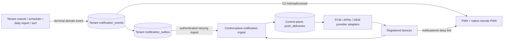

# Commercial Mobile Experience Audit and Delivery Plan

- **Status:** Proposed for owner review
- **Date:** 2026-11-20
- **Code baseline:** `main` at `90025002b` (`package.json` 1.1.1)
- **Scope:** mobile PWA, Android/iOS Capacitor shell, tenant events and settings, control-plane device/push integration, and desktop-to-mobile product parity

## 1. Purpose and Product Outcome

IDBots should become a consumer-ready personal-agent mobile product, not a smaller desktop settings console and not only a chat demo. The primary daily loop is:

> Sign in easily → understand what the Twin can do → assign work with confidence → leave the app → receive a useful notification → open the exact result or pending decision → control the Bot's autonomy, memory, and cost.

The first commercial release should optimize this loop before adding more advanced surfaces. Existing PWA and Capacitor architecture stays in place. There is no React Native rewrite and no second Agent implementation in the native shell.

## 2. Evidence and Boundaries

This review covered:

- Mobile entries, shell, chat, tasks, browser, settings, Bot editor, login, gateway/resync, native adapter, and mock bridge under `src/mobile/`.
- Android manifest, Gradle configuration, Java plugins, lifecycle, update flow, iOS configuration, and native delivery notes under `mobile-shell/`.
- Tenant task completion, scheduler, desktop notification, daily-report, surf, memory, and per-Bot settings code under `src/main/`.
- Desktop settings, MetaBot editor, surf reports, daily report, memory, permissions, and session UI under `src/renderer/`.
- Control-plane schema, authentication, public routes, tenant lookup, and WebSocket proxy under `cloud/control-plane/`.
- The frozen contracts and current mobile allowlist in `01-interface-contracts.md` and `02-ipc-allowlist-v1.md`.
- A manual click-through of the current mock PWA at a 412 × 915 Android viewport: login, chat, tasks, Me, Bot list, and Bot editor.

This was a code and mock-UI audit. It was not a physical-device, real-tenant, FCM/APNs, Chinese-OEM, or production acceptance run. Those remain explicit verification gates below.

## 3. Executive Assessment

The current mobile product already has a useful foundation:

- Shared per-session chat state and recovery, full permission questions, voice input, attachments, artifact preview/share, and Assistant-oriented message presentation.
- A visually coherent four-tab shell, a strong unified task board, scheduled-task management, and good mobile touch-oriented components.
- On-chain Bot creation/edit flows, primary/fallback model configuration, global skills and memory switches, ME credits/recharge recovery, NFT and WeChat surfaces.
- A real Capacitor shell with exact-origin navigation, native lifecycle recovery, camera/files/share, secure screens, offline error UI, and verified APK self-update.

The largest problems are therefore not a lack of screens or general visual polish. They are missing commercial loops and inconsistent product ownership:

1. **Work can finish, but the product has no durable notification/inbox model and no system push path.** A user must return and inspect tasks manually.
2. **Notification taps cannot have reliable destinations because mobile navigation is mostly local state rather than deep-linkable routes.**
3. **The mobile Bot editor omits the autonomy controls that make IDBots valuable:** surf, daily report, knowledge/dream, and some Bot lifecycle/recovery actions.
4. **Login and first-run experience still contain prototype behavior and launch placeholders.** Cold startup can wait on a remote settings read before rendering React.
5. **The information hierarchy over-prioritizes billing and advanced asset features above notification, automation, and everyday agent controls.**
6. **Several desktop capabilities were deliberately deferred in earlier packages. Those decisions are visible in code and must now be revisited as a new commercial-readiness phase, not treated as accidental bugs.**

## 4. Prioritized Findings

Priority meanings:

- **P0:** required for a trustworthy commercial core loop.
- **P1:** required for broad daily use and reasonable desktop-outcome parity.
- **P2:** useful after the core product is reliable and accepted.

| Area | Evidence | Finding and required outcome | Priority |
|---|---|---|---|
| System push | `docs/cloud-mobile/50-ws-e-mobile-client.md:319-323`, `mobile-shell/package.json:26-34`, `mobile-shell/android/app/src/main/AndroidManifest.xml:4-7` | Push was explicitly out of scope. There is no push dependency, device-token flow, Android notification permission, or APNs capability. Build a server-driven notification architecture, not only a local plugin. | P0 |
| Durable inbox | `src/mobile/app/MobileApp.tsx:64-84`, `src/mobile/app/components/TabBar.tsx:31-33` | Only waiting-owner task count has a badge. Completed work, failures, daily reports, and missed decisions have no persistent unread inbox. Add a tenant-authoritative notification center. | P0 |
| Completion events | `src/main/main.ts:9451-9467`, `src/main/libs/scheduler.ts:779-799` | Ordinary cowork completion is forwarded to connected renderers only. Scheduled runs notify configured IM platforms, not mobile devices. Emit a shared domain event once at authoritative terminal states. | P0 |
| Scheduled-task delivery | `src/mobile/app/hooks/useScheduledTasks.ts:13-32` | Mobile create always writes `notifyPlatforms: []`; the only existing delivery preference cannot be configured. Replace this hidden dead end with the new notification model. | P0 |
| Deep links | `src/mobile/app/MobileApp.tsx:42-50`, `src/mobile/login/main.tsx:125-128`, `src/mobile/app/MobileApp.tsx:173-177` | Tabs and secondary pages are state-driven. Login redirects to a fixed `/app/`, and unauthorized navigation discards the intended destination. Add typed routes and return-path preservation before push. | P0 |
| Native Android coverage | `mobile-shell/README.md:21-29`, `mobile-shell/android/app/build.gradle:81-88` | The Gradle file contains a stock google-services placeholder, not a working push implementation. FCM alone is not sufficient for a mainland-China fleet; introduce a provider abstraction and OEM acceptance plan. | P0 for abstraction, launch gate for OEM coverage |
| Surf controls | `src/renderer/components/metabots/SurfSection.tsx:21-31`, `src/mobile/app/components/BotEditorForm.tsx:47-48` | Desktop supports pre-dream surf, interaction/creation budgets, creation mode, run now, and reports. Mobile has none. Reuse the existing whitelisted per-Bot settings rather than creating a second store. | P0/P1 |
| Surf APIs | `src/main/gateway/allowlist.ts:281-284` | `surf:listRuns` and `runNow` are P2, while the newer day-index APIs are N. A mobile Surf release needs an explicit CR and gateway-tier rollout, not a UI-only change. | P0/P1 |
| Daily report | `src/main/gateway/allowlist.ts:348-358`, `src/renderer/components/metabots/DailyReportSection.tsx:23-29` | Per-Twin enable/hour settings already use allowed `metabot:getSetting/setSetting`, but `dailyReport:runNow` and the global experimental-automation controls are N. The service itself starts in the shared main process and creates a normal Twin session. Port controls and completion notification through CRs. | P0/P1 |
| Bot lifecycle | `src/mobile/app/screens/me/BotsPage.tsx:14-20`, `src/mobile/app/hooks/useMetabots.ts:49-54` | The current list removed enable/disable, chain status, resume, and sync actions even though the hook still supports them. Restore these in Bot detail/status UI; do not leave recovery desktop-only. | P1 |
| General settings | `src/mobile/app/screens/me/GeneralPage.tsx:30-37` | Only language and theme are exposed. Add relevant automation/safety controls; do not port auto-launch, prevent-sleep, keyboard shortcuts, or desktop Studio switches. | P0/P1 |
| Memory | `src/mobile/app/screens/me/MemoryPage.tsx:6-16`, `src/renderer/components/settings/MemorySettings.tsx:49-50` | Mobile exposes only three global switches, while desktop has knowledge, facts, contacts, dreams, culture, standing pages, and policy controls. Add user-visible/searchable/removable memory before advanced dream/culture surfaces. Trust requires more than switches. | P1 |
| Archived chats | `src/mobile/app/screens/ChatScreen.tsx:66-70` | Mobile archive tells the user to restore on desktop, despite existing archive/list/unarchive support. This is an unnecessary cross-device dead end. | P1 |
| Login production readiness | `src/mobile/login/main.tsx:316-407`, `src/mobile/app/screens/me/AboutPage.tsx:7-17` | Inputs rely on placeholders, async labels do not change, errors are global, and staging legal/support placeholders remain. Production legal links and support are launch blockers. | P0 |
| Preparing/recovery | `src/mobile/login/main.tsx:108-169`, `src/mobile/app/components/GatewayTerminalScreens.tsx:23-52` | Provisioning shows raw phase/error text, transient polling failures are silent, and terminal screens can become endless waits. Add progress, elapsed time, retry/support/sign-out recovery, and safe copy. | P0 |
| Cold startup | `src/mobile/app/bootstrap.tsx:13-28`, `src/mobile/bridge/gatewayClient.ts:37-39` | React mounts only after `store.get('app_config')`. A disconnected invoke can wait up to 15 seconds while the launch screen remains. Render the shell immediately and hydrate preferences in the background. | P0 |
| Me information hierarchy | `src/mobile/app/screens/MeScreen.tsx:353-408` and mock visual review | The large ME hero consumes most of the first viewport and duplicates the Usage entry. Notifications, Bots, and automation should precede monetization in everyday use; keep the full hero inside Usage or show it conditionally. | P1 |
| Navigation state | `src/mobile/app/MobileApp.tsx:205-249`, `src/mobile/app/screens/MeScreen.tsx:123-131` | Chat/Tasks/Me screens unmount on tab changes; Me subpages and UI scroll/filter state are not durable routes. Preserve route, scroll, drafts, and filters across tab switches and OS eviction. | P1 |
| Accessibility | `src/mobile/app/components/BottomSheet.tsx:19-46`, `src/mobile/app/twin-ui.css:317-321`, `src/mobile/app/screens/ChatScreen.tsx:138-146` | Sheets lack explicit modal/focus management; several targets are 20–40 px rather than 44–48 px. Add focus trap/restore, accessible close labels, dynamic text checks, and a touch-target sweep. | P1 |
| Device/account control | `cloud/control-plane/src/db/migrations.ts:48-57`, `src/mobile/app/components/GatewayTerminalScreens.tsx:79-100` | Login sessions exist but there is no user-facing device list/revocation. Push makes installation identity and token revocation necessary. | P1 |

## 5. Target Mobile Product Structure

Keep the existing four bottom tabs for the first commercial iteration: **Chat, Browser, Tasks, Me**. Do not add a fifth tab merely for notifications.

- **Chat:** Twin-first conversation, session history, attachments/voice, and a shared notification bell with unread count.
- **Tasks:** active work, scheduled work, waiting decisions, run history, and results. It remains the operational center.
- **Browser:** preserve the existing differentiated IDBots capability; do not let it displace core notification work.
- **Me:** Notifications, My Bots, Usage, Memory, Skills, Models, General, Account/Security, About. NFT and WeChat are secondary services, not more important than notification and automation.
- **Notification center:** a full-screen route opened from the shared bell and Me → Notifications, with filters for Unread, Work, Action required, Reports, and System.
- **Bot detail:** retain a compact tab model. Put Surf and Twin Daily Report in an **Automation** tab/section rather than blindly adding more desktop tabs to the existing five-tab strip. Bot status, enable/disable, sync/resume, and cost effects belong in an observable status area.

The design should preserve the existing neutral surfaces, yellow accent, Heroicons, light/dark tokens, and task/chat visual language. It should not adopt a new visual theme merely to appear commercial.

## 6. Notification Architecture

### 6.1 Non-negotiable principles

1. **The tenant notification record is the source of truth.** A push message is only a delivery hint.
2. **Persist first, deliver second.** Task execution must never wait for FCM/APNs/OEM delivery or fail because a provider is unavailable.
3. **At-least-once transport plus stable-ID dedupe.** Do not promise exactly-once push. The inbox and each device dedupe by `eventId`.
4. **Terminal and actionable events only.** Never push streaming deltas, raw tool calls, worker-internal events, or every background heartbeat.
5. **A notification opens a route; it never performs an action.** Approval, payment, retry, and chain writes still require the normal UI and policy.
6. **Minimal lock-screen content by default.** No full prompt/answer, signed URL, cookie, mnemonic, API key, redeem code, or payment QR in a push payload.
7. **PWA and native capabilities are honest.** The first PWA release gets the persistent inbox and in-app banners; background system push is native-first. A future push-only service worker can be considered without introducing an offline asset cache.
8. **Provider-neutral from day one.** FCM is a reference adapter, not a claim of reliable mainland-China coverage.

### 6.2 End-to-end flow



### 6.3 Ownership and storage

**Tenant main process (desktop and cloud shared):**

- `notification_events`: stable `eventId`, type, created time, Bot/session/task/run references, safe title/body, priority, read state, and route target.
- `notification_outbox`: event ID, attempt count, next retry, last error, and delivery state. Additive idempotent migrations are required.
- Domain producers emit through one notification service at authoritative terminal points. Desktop can consume the same event model for its system notifications.

**Control plane:**

- `user_devices`: `deviceId`, `userId`, random `installationId`, platform, provider, encrypted provider token, app/shell versions, enabled/invalid state, created/last-seen time.
- `push_deliveries`: unique `(eventId, deviceId)`, provider message ID, state, attempts, next retry, and sanitized provider error class.
- `notification_preferences`: global/category push switches and, later, quiet hours. Per-Bot push preferences remain a later additive feature.
- An authenticated tenant-to-control-plane ingest endpoint validates tenant identity, event shape, size, and rate. Reuse the existing per-tenant credential or introduce an equivalent narrowly scoped credential through CR; never accept a user-supplied tenant ID as proof.

**Mobile client:**

- C2 reads the inbox, unread count, and mark-read state.
- C3 registers/unregisters the current installation and manages push preferences using the existing HttpOnly cookie.
- The provider token is passed directly through the native adapter to registration. It is not written to localStorage or logged.
- Logout revokes the current installation token; account deletion invalidates all device tokens. Other devices stay logged in unless the user explicitly revokes them.

### 6.4 Initial event envelope

The exact schema belongs in a CR, but it should carry approximately:

```ts
type AgentNotificationEvent = {
  eventId: string;                 // UUID, stable across retries/restarts
  type: string;                    // versioned catalog, e.g. work.completed
  createdAt: number;
  metabotId: number | null;
  sessionId: string | null;
  taskId: string | null;
  runId: string | null;
  title: string;                   // short, sanitized, localized at production
  body: string;                    // short summary, never raw transcript/tool args
  priority: 'normal' | 'high';
  target: { kind: 'notification'; notificationId: string };
};
```

The client resolves `notificationId` through the authenticated inbox and only then opens the referenced session/task. It must not trust an arbitrary route supplied by a push provider.

### 6.5 Initial event catalog

| Event | Push behavior | Destination |
|---|---|---|
| Explicit user work completed/failed | Notify when the work is no longer being actively viewed; coalesce by turn ID | Exact cowork session/turn |
| Scheduled run completed/completed_empty/crashed/timeout | Success normal; failure high; dedupe by run ID | Scheduled run receipt, then result session |
| Long-term task waiting for owner / completed / failed | Waiting and failure high; dedupe by task transition | Exact task/detail or pending decision |
| Permission or clarification required | High priority; expire when already resolved; never include an approve action | Existing permission sheet in the correct session |
| Daily report ready / failed | Ready normal, failure high; dedupe by report run ID | Daily-report session and full HTML artifact |
| Surf run completed / failed | Category-controlled, P1 after Surf UI ships | Bot → Automation → Surf report |
| Quota/service availability problems | Optional P1; no repeated provider-error storm | Recovery/usage screen |

Background worker/internal orchestration messages do not automatically become owner notifications. The event producer must classify owner relevance explicitly.

### 6.6 Native shell and providers

- Add Capacitor push/local notification integration through the existing typed native bootstrap and `MobileNativeAdapter`; add a native bridge version extension rather than an untyped global.
- Android 13+ requests notification permission at a contextual moment, not at first cold launch. Create channels for Work, Action required, Reports, and System. Use stable notification tags for dedupe/update.
- iOS adds APNs entitlement/capability and the same token/deep-link flow when the iOS release is scheduled.
- Start with an FCM reference adapter and fake provider tests. Before broad mainland promotion, add either the required Huawei/Xiaomi/OPPO/vivo/Honor adapters or a compliant aggregation provider. Record the provider/privacy decision explicitly.
- Do not request battery-optimization exemptions indiscriminately. Show OEM-specific guidance only where device testing proves it necessary.
- Push payload contains `eventId`, category, and safe display text. No authorization is derived from payload data.

### 6.7 Deep links and read state

Introduce a small typed route resolver shared by PWA and native intents:

- `/app/notifications/:notificationId`
- `/app/sessions/:sessionId`
- `/app/tasks/:taskId`
- `/app/scheduled/:taskId/runs/:runId`
- `/app/bots/:metabotId/automation?tab=surf|daily-report`

Native cold start queues the route until the remote PWA and authentication are ready. If login is required, preserve the full return path through `/login`. After navigation, fetch authoritative state and mark only the opened notification read. `notification:changed` updates bells/badges across connected devices; reconnect reconciles unread state from the tenant.

### 6.8 Notification UX and preferences

The first settings page includes:

- Master push switch and OS-permission state/open-system-settings action.
- Independent categories: Work results, Action required, Daily reports, System/account.
- Surf/dream/social categories only when those surfaces exist.
- Quiet hours, per-Bot overrides, sound/vibration, and lock-screen preview controls as a following iteration.

In-app banners do not cover the composer or pending permission card. Opening the current destination suppresses redundant banners. A completed task remains in the inbox even when the system push was dismissed.

## 7. Desktop-to-Mobile Parity Decisions

“Parity” means equivalent user outcomes with phone-appropriate presentation, not identical desktop panels.

| Desktop capability | Mobile decision | Implementation note |
|---|---|---|
| Surf before dream, interaction/creation budgets, creation mode | **Port now** | Reuse `metabot:getSetting/setSetting` and shared setting definitions/defaults. Show token/traffic consequences beside controls. |
| Surf now, running state, reports/calendar | **Port now/next** | CR for run/day APIs and explicit gateway tier. Use a mobile report list/date sheet rather than desktop popovers. |
| Twin daily report enable/hour/run now | **Port now** | Twin-only Automation section. Keep explicit opt-in and global gate. Add notification and result deep link. |
| Experimental automation master switch | **Port with safety copy** | CR from N. Explain browser/computer automation semantics for a cloud tenant; do not imply the phone itself is controlled. |
| Bot enable/disable and chain sync/resume | **Port now/next** | Existing hook methods suffice; surface confirmed/partial/uncertain outcomes. |
| Knowledge base | **Port next** | Corpus list, add/learn, status, and error recovery; avoid desktop file-tree assumptions. |
| Dream status, diary, manual run | **Port next** | Useful for understanding the evolving Bot; group with memory/automation rather than a new top-level destination. |
| Memory switches | **Already present** | Preserve readback-confirmed writes. |
| Memory facts/knowledge/contacts | **Port next** | Search, view, edit/archive/delete with scope and provenance. Add advanced hygiene later. |
| Dream culture/standing pages/telemetry | **Later** | Advanced transparency; do not block the first commercial loop. |
| Archived chats | **Port next** | List, restore, filter; mobile already supports archive. |
| Global model/provider configuration | **Already substantially present** | Retain. Per-session model/effort can be a progressive-disclosure chat option. |
| Skills enable/disable | **Already present** | Add visible write errors and saving state. |
| Skill marketplace/install/config | **Later** | Do not displace notification and core reliability. |
| Projects/workspace file management | **Selective/later** | Cloud-relevant read-only project selection first; no desktop file-manager clone. |
| IM bot and e-mail gateways | **Do not port for this phase** | The new notification architecture is the consumer path. IM remains a separate power-user channel decision. |
| Auto-launch, prevent sleep, shortcuts | **Do not port** | Desktop host concepts. |
| Desktop computer-use/MCP/local file tools | **Do not expose blindly** | Require cloud safety/product review; the phone is not a remote desktop controller. |
| Wallet, mnemonic, chain backup | **Security track** | Complete re-verified export and account continuity before broad self-custody claims. |
| Square/social/group-task breadth | **Later** | Keep outside the first notification/settings stabilization slice. |

## 8. Experience Improvements Beyond Feature Parity

### 8.1 Login and first run

- Use a compact branded screen with a visible phone label, fixed `+86` presentation, phone autofill, numeric one-time-code input, inline resend, and a single clear primary action per step.
- Validate near the relevant field. Distinguish sending, verifying, retrying, rate-limited, expired, offline, and unknown outcomes. Disable duplicate submission and show progress in the button.
- Preserve invite/display-name steps and legal consent, but record accepted policy versions server-side so returning users do not repeatedly accept unchanged terms.
- Replace staging legal URLs with environment-specific production configuration. Provide real Terms, Privacy, Custody, and Support destinations before release.
- Keep return paths through session recovery and unauthorized redirects.
- Turn Preparing into a truthful staged progress view with elapsed time, safe phase copy, retry, support, and sign-out. Never expose raw infrastructure errors as the main user message.
- Finish with a short “Your Twin is ready” moment and three useful starter actions: ask a question, assign a background task, create a daily report/schedule. Do not add a long tutorial carousel.
- Ask for notification permission after the user assigns the first background-eligible task or enables daily report, with a concrete explanation.

### 8.2 Startup and recovery

- Remove the blocking remote settings read from initial React render. Apply device/default theme immediately, render shell/connection state, hydrate preferences asynchronously, and remove splash after the first meaningful paint.
- Preserve the no-offline-execution promise. Show cached visual shell only as stale/offline presentation, never as a claim that work can run offline.
- Add manual retry/support to tenant-unavailable and version-mismatch screens. Native version mismatch should offer the existing verified update path.
- Restore route, selected task/filter, session scroll, and drafts across tab changes and OS eviction. Keep authoritative server reconciliation.

### 8.3 Me and Bot experience

- Replace the default full-height ME hero with a compact balance/plan row; keep the rich hero in Usage or show it for low quota/upgrade intent. Remove duplicate emphasis on Usage.
- Put Notifications and My Bots before secondary services. Add Automation status summaries such as “Surf on · Daily 08:00”.
- Add Bot operational status (enabled, chain sync, running automation) and recovery to Bot detail.
- Keep advanced fields progressively disclosed. The existing five-tab strip is already dense; consolidate rather than stacking separate Surf, Daily, Dream, Knowledge, and Advanced tabs without hierarchy.

### 8.4 Chat and tasks

- Add archived-chat list/restore and remove “restore on desktop” as the only recovery path.
- Preserve the existing strong permission, artifact, and task-center implementations. Notification deep links should reuse them, not create separate result pages.
- Add per-session execution/approval preferences only through a simple advanced sheet; do not crowd the composer with desktop controls.
- Show scheduled-task notification behavior in plain language: “IDBots will notify you when this run finishes or needs you.”

### 8.5 Visual quality, accessibility, and performance

- Reuse the current design tokens and component family; avoid a wholesale reskin.
- Guarantee 44–48 px hit areas, including clear/retry/avatar/small buttons. Add pressed, loading, disabled, success, and failure states consistently.
- Add `aria-modal`, focus trap/initial focus/restore, labelled close controls, and screen-reader announcements to sheets and async forms.
- Verify 375 px small phones, large Android devices, landscape, largest dynamic text, reduced motion, and independent light/dark contrast.
- Measure real usable-chat paint and route chunk cost on mid-range Android/4G. Reduce duplicate hook-level roster/config requests where profiling confirms waste.
- Keep the existing PWA no-cache/version-matching policy. If PWA push is later added, use a push-only service worker with no offline application cache.

## 9. Dependency-Ordered Delivery Packages

Each package uses its own branch/worktree from current `main`, tests, and owner-approved merge. Acceptance is on a `main`-built artifact.

| Package | Priority | Depends on | Deliverable and exit |
|---|---|---|---|
| **CM0 — Contracts, event catalog, and fixtures** | P0 | Owner approves direction | CRs for notification ingest/C2/C3 and Surf/Daily/API tiers; deterministic fixtures for terminal events, retries, duplicate delivery, and deep links. No production provider secrets required. |
| **CM1 — Tenant inbox and deep-link foundation** | P0 | CM0 | Persistent notification/outbox, C2 inbox/read/unread, notification center, typed routes, login return paths, and task/session/permission destinations. PWA can receive and reopen every event without native push. |
| **CM2 — Control-plane devices and Android reference push** | P0 | CM1 | Device registration/revocation, push preferences, delivery outbox/worker, fake + FCM adapters, Android permission/channels/token flow, cold/warm deep links. Logout/reinstall/multi-device behavior passes. |
| **CM3 — Bot automation parity and event coverage** | P0/P1 | CM0; integrates with CM1/CM2 | Surf controls/run/reports, Twin daily report controls/run, relevant global automation switch, Bot enable/sync recovery, and scheduled/long-term/daily/surf notification producers. Existing settings remain compatible. |
| **CM4 — Commercial login and first-run experience** | P0 | Can proceed in parallel with CM1–CM3 | Non-blocking startup, production legal/support configuration, redesigned login/preparing/recovery, starter actions, contextual notification opt-in. Real C3 sign-up/sign-in/recovery passes. |
| **CM5 — Daily-use completeness and UX quality** | P1 | CM1–CM4 core stable | Archived chats, memory view/manage, Bot detail status, Me hierarchy, navigation preservation, accessibility/touch/focus sweep, profiling and route performance. |
| **CM6 — Scale and launch hardening** | P1 before broad promotion | CM2/CM3 accepted | Chinese-OEM provider coverage, APNs when scheduled, delivery metrics/alerts, provider failure injection, physical-device matrix, real tenant/model runs, privacy/legal review, backup/restore with notification data. |

Do not hold CM1 hostage to a push-provider decision. The durable inbox and deep links are independently useful and are the correct foundation for every provider.

## 10. Contract Change-Request Backlog

No frozen contract is edited by this plan. Required proposals are:

1. **Notification domain IPC:** additive `notification:list/get/getUnreadCount/markRead/markAllRead/getPreferences/setPreferences` as needed, plus `notification:changed`. Use a narrow schema and explicit allowlist tests.
2. **Tenant-to-control-plane event ingest:** authenticated, bounded, idempotent notification envelope and retry/ack semantics.
3. **C3 device APIs:** register/unregister/current-device and push-preference routes, with cookie auth and Origin enforcement.
4. **Daily report:** reclassify `dailyReport:runNow` from N after cloud semantics and resource usage are reviewed.
5. **Automation switch:** reclassify `app:getExperimentalAutomation` and `app:setExperimentalAutomation` from N with cloud-safe copy and security review.
6. **Surf:** enable `surf:listRuns`/`runNow` through the intended tier rollout and add `surf:listRunsByDay`/`listRunDays` through CR, or provide one composed mobile surf facade if that proves less chatty.
7. **Deep-link version behavior:** document additive client route behavior; no arbitrary external navigation or approval side effects.

Tier expansion is backward-compatible only after the corresponding security and resource review. Update contract versions and gateway `welcome` evidence in the implementing change, not in advance.

## 11. Acceptance and Measurement

### 11.1 Notification acceptance matrix

Test every applicable event in foreground, background, process-killed, offline, and reconnect states:

- Explicit chat work, scheduled run, long-term waiting/completion, permission question, and daily report.
- Cold and warm notification taps land on the exact existing UI; logged-out taps preserve the return path.
- Duplicate terminal events and tenant/control-plane restarts do not create duplicate inbox rows or device deliveries.
- Provider timeout, invalid token, revoked token, logout, reinstall, account deletion, and multiple devices behave correctly.
- Resolving a permission on another device prevents any further action from the stale notification; it never auto-approves.
- No message content, tool arguments, provider tokens, cookies, signed URLs, or secrets appear in logs or push payloads.
- Xiaomi, Huawei/HarmonyOS supported by the APK, OPPO/vivo, Google-services Android, iPhone when scheduled, and PWA-only behavior are reported separately. Missing devices/providers are **NOT RUN**, not pass.

### 11.2 Experience acceptance

- Real sign-up → provisioning → first Twin chat → first background task → notification → result is one continuous journey.
- Cold app open to usable chat meets the existing P95 target on the agreed device/network profile; a disconnected settings read never blocks first render for 15 seconds.
- Surf and daily-report settings persist after reconnect/restart and match desktop behavior/defaults. Costs and global gates are visible before activation.
- Archive/restore, Bot disable/recovery, and memory management no longer require desktop.
- All critical flows pass at 375 px, large text, reduced motion, light/dark themes, and screen-reader smoke checks.

### 11.3 Privacy-safe product telemetry

Measure without message contents or provider tokens:

- Sign-up start/success, tenant-ready rate/time, first message, first task accepted/result, and first-week return.
- Notification permission opt-in, event-to-provider latency, provider acceptance/failure by class, deep-link open success, and unread reconciliation.
- Login error category, cold usable paint, reconnect/resync outcome, and route chunk performance.
- Activation definition: a new user reaches one real agent result, not merely a successful SMS login.

A system-provider “accepted” metric is not represented as guaranteed handset delivery; physical-device delivery remains a separate measure.

## 12. Assumptions and Non-Goals

- Mainland-China consumer use remains the primary launch audience; desktop and PWA remain supported products.
- The current single-tenant backend and thin control plane remain. Notification routing does not move Agent orchestration into the control plane.
- Native push uses a provider abstraction; the final Chinese-OEM/aggregation vendor is a procurement/privacy decision rather than an assumption in this document.
- Initial PWA support is inbox/in-app only for closed-app scenarios. Native system push is the reliable background path; PWA push is a later additive evaluation.
- Notification copy is conservative by default. Detailed content previews, quiet hours, and per-Bot notification rules follow after the base architecture is reliable.
- No React Native rewrite, offline Agent execution, phone-to-desktop remote control, broad desktop-settings clone, or store submission is implied by this plan.
