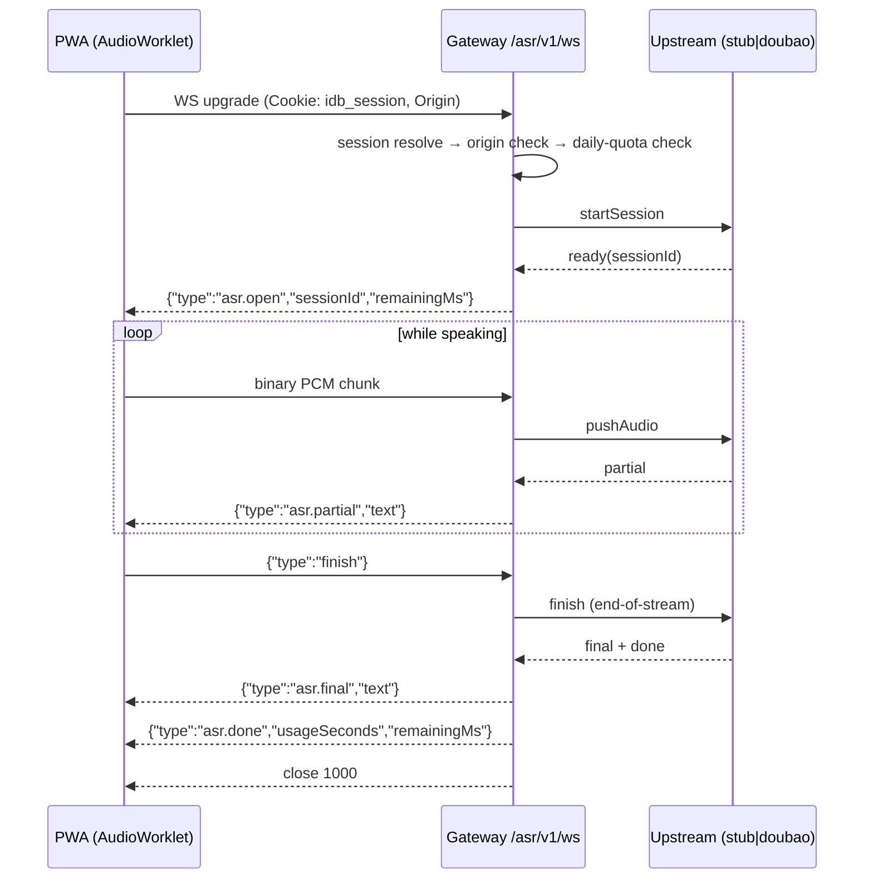

# ASR Voice Channel — Gateway WebSocket Protocol (v1)

Status: **frozen for parallel development** (2026-10-31, branch `feat/asr-gateway`).
This is a **new, independent channel document** for the voice-input capability.
It does not modify the frozen C2/C3 interface contracts (`../01-interface-contracts.md`,
`../02-ipc-allowlist-v1.md`); any interaction with those goes through a change request.

Audience: the PWA voice-input frontend (AudioWorklet capture + streaming backfill),
developed in parallel with the gateway. Everything the frontend needs is in
sections 2–7. The gateway ships with a **stub upstream** by default, so the
frontend can integrate today — no Volcano credentials required.

---

## 1. Overview

| | |
|---|---|
| Endpoint | `wss://<same-origin>/asr/v1/ws` (upgraded by the control plane) |
| Auth | The `idb_session` cookie — same session as every `/api/v1` route. Browsers send it automatically on a same-origin WebSocket handshake. No extra token. |
| Audio in | Binary frames: PCM **s16le, 16 kHz, mono**. Send 100–200 ms per chunk (3200–6400 bytes), like the upstream provider's packet guidance. |
| Events out | JSON text frames (`asr.open` / `asr.partial` / `asr.final` / `asr.done` / `asr.error`). |
| Free quota | **60 minutes/day per user** (config `CP_ASR_DAILY_LIMIT_MINUTES`), metered as wall-clock streaming time; one connection ≤ 600 s (`CP_ASR_MAX_SESSION_SECONDS`). |
| Preflight | `GET /api/v1/asr/quota` (cookie) → `{ limitMinutes, limitSeconds, usedSeconds, remainingSeconds, dayStartMs, timezone, upstream }`. Use it to grey out the mic button. |

Sister endpoint: the chat proxy `/ws` (C2/C3). The ASR channel deliberately
uses its own close-code block (**41xx**) so the two can never be confused.

## 2. Connection lifecycle



The client may send audio immediately after the WS opens; chunks sent before
`asr.open` are buffered (up to 64 chunks) and flushed when the upstream is
ready — but prefer waiting for `asr.open` (it normally arrives within tens of
milliseconds with the stub, ~100–300 ms with Doubao).

Mid-stream upstream loss (rare): the gateway emits
`asr.error {code:"UPSTREAM_LOST", retryable:true}`, **reopens the upstream
itself**, and re-emits `asr.open` — the client socket stays alive. The
frontend should keep the last partial in the input box and keep streaming;
recognition restarts from the reconnect (a fraction of a second of audio may
be lost). After `finish`, no reconnect happens.

## 3. Client → gateway frames

| Frame | Format | Meaning |
|---|---|---|
| Audio | binary, PCM s16le 16 kHz mono | One 100–200 ms chunk. Empty chunks ignored. |
| `{"type":"finish"}` | text/JSON | No more audio. Triggers finalization; `asr.final` + `asr.done` + close 1000 follow. |
| `{"type":"abort"}` | text/JSON | Cancel now. Gateway closes 1000; usage still recorded. |

Anything else (non-JSON text, unknown `type`) → close **4106**.

## 4. Gateway → client events

```jsonc
{"type":"asr.open","sessionId":"stub-…","remainingMs":3599870}
{"type":"asr.partial","text":"今天天"}          // interim hypothesis; replaces the previous partial
{"type":"asr.final","text":"今天天气怎么样？"}    // definite utterance (VAD-finalized)
{"type":"asr.done","usageSeconds":3.2,"remainingMs":3596870,"upstreamDurationMs":3200}
{"type":"asr.error","code":"UPSTREAM_LOST","message":"…","retryable":true}
```

Notes for the input-box backfill UX:

- On `asr.partial`: replace the trailing interim segment with `text`.
- On `asr.final`: commit `text` as stable text (append after previously
  committed finals, drop the interim segment). With VAD endpointing
  (`end_window_size` 800 ms) a long press-to-talk produces several finals.
- `asr.done` closes the interaction; the socket then closes with 1000.
- With the **stub upstream** the transcript is always the fixed sentence
  `今天天气怎么样` (partials grow towards it), regardless of the real audio.

## 5. Close codes (ASR block 41xx)

| Code | Meaning | Frontend action |
|---|---|---|
| 1000 | Normal end (`asr.done` seen, or client `abort`) | — |
| 4101 | No/invalid session cookie | Send the user to login |
| 4103 | Origin not allowed | Bug in the frontend (cross-origin) |
| 4104 | Daily quota exhausted **or** per-session cap reached (the `asr.error` right before says `QUOTA_EXHAUSTED` vs `SESSION_CAP`) | Show quota UI; SESSION_CAP → reconnect immediately (a fresh connection is allowed while quota remains) |
| 4105 | Upstream unavailable / fatal upstream error | Toast "语音服务暂不可用，请重试" |
| 4106 | Protocol violation (bad control frame, or >64 buffered chunks while upstream is down) | Bug in the frontend |
| 1011/1006 | Gateway fault / keepalive timeout | Auto-retry once |

Error codes on the `asr.error` event: `UPSTREAM_LOST` (retryable, gateway
handles it), `QUOTA_EXHAUSTED`, `SESSION_CAP`, `DOUBAO_<code>` (provider
error, not retryable), `STUB_*`.

## 6. Quota semantics

- Metered per user as the sum of connection durations (socket open→close),
  against the Asia/Shanghai calendar day of the connection's start.
- Rejected connections (4101/4103/4104 at upgrade) consume nothing.
- `remainingMs` on `asr.open` is this connection's wall-clock budget (daily
  remainder capped by the per-session cap); when it runs out the gateway
  sends `asr.error` + closes 4104.
- Server-side usage rows (`asr_usage`) are the accounting source of truth;
  `GET /api/v1/asr/quota` is the read API.

## 7. Frontend capture guidance (summary)

- AudioWorklet → 16 kHz mono Float32 → convert to Int16 LE in the worklet →
  post 3200-byte chunks every 100 ms (or 6400/200 ms).
- iOS Safari: AudioWorklet is available from 14.5+; `getUserMedia` needs a
  user gesture and HTTPS — the PWA already satisfies both. Resume the
  AudioContext on the same gesture that shows the mic button.
- Lock-screen/tab-kill: irrelevant for short press-to-talk interactions;
  if the socket dies the browser fires close → treat as abort.
- Do not send audio while `readyState !== OPEN`.

## 8. Upstream pluggability (gateway-internal)

`UpstreamProvider` (`src/services/asr/types.ts`): `startSession({userId, onEvent})`
→ `{pushAudio, finish, abort}`; events `ready/partial/final/done/error`.

| Upstream | State | Config |
|---|---|---|
| `stub` (default) | Fully working; fixed transcript; fault injection via `CP_ASR_STUB_DELAY_MS`, `CP_ASR_STUB_DISCONNECT_AFTER_MS`, `CP_ASR_STUB_SLOW_FINAL_MS` for joint debugging | none |
| `doubao` | Implemented per the official SAUC v3 protocol (framing validated by protocol-level tests against a local fake server). **Not yet live-tested** — Volcano credentials absent; when they arrive set the env vars below, switch `CP_ASR_UPSTREAM=doubao`; client protocol unchanged. | `CP_ASR_DOUBAO_API_KEY` (preferred) or `CP_ASR_DOUBAO_APP_ID` + `CP_ASR_DOUBAO_ACCESS_TOKEN`; optional `CP_ASR_DOUBAO_ENDPOINT`, `CP_ASR_DOUBAO_RESOURCE_ID` (default `volc.seedasr.sauc.duration`) |
| `funasr` | Reserved slot (`upstream-funasr.ts`): selectable but start fails loudly until implemented | `CP_ASR_FUNASR_ENDPOINT` |

Credential discipline: Volcano secrets exist **only** as environment
variables on the server. They are never committed, logged, or sent on chain.

## 9. Configuration reference (control plane)

| Env | Default | Meaning |
|---|---|---|
| `CP_ASR_UPSTREAM` | `stub` | `stub` \| `doubao` \| `funasr` |
| `CP_ASR_DAILY_LIMIT_MINUTES` | `60` | Per-user daily free minutes |
| `CP_ASR_MAX_SESSION_SECONDS` | `600` | Per-connection hard cap |
| `CP_ASR_STUB_DELAY_MS` / `_DISCONNECT_AFTER_MS` / `_SLOW_FINAL_MS` | `0` | Stub fault injection for joint debugging |
| `CP_ASR_DOUBAO_API_KEY` | — | Volcano API key (env-only secret) |
| `CP_ASR_DOUBAO_APP_ID` / `CP_ASR_DOUBAO_ACCESS_TOKEN` | — | Legacy credential pair (env-only) |
| `CP_ASR_DOUBAO_ENDPOINT` | `wss://openspeech.bytedance.com/api/v3/sauc/bigmodel_async` | Doubao 2.0 optimized bidirectional endpoint |
| `CP_ASR_FUNASR_ENDPOINT` | — | Reserved |

Selecting `doubao` without credentials is a startup error (config validation).

## 10. Test coverage map

| Suite | File | Covers |
|---|---|---|
| Quota unit | `test/asr-quota.test.ts` | Day boundary (UTC+8), closed+open accumulation, crash-leftover capping, row fields |
| Stub unit | `test/asr-stub.test.ts` | Fixed transcript, delay, disconnect injection, slow final |
| Doubao protocol | `test/asr-doubao.test.ts` | SAUC v3 framing vs a fake server: handshake headers, full-client request fields, audio round-trip, EOS flag, event mapping, error frames, transport drop |
| Gateway integration | `test/asr-gateway.test.ts` | 4101/4103 auth, e2e happy path, abort, 4106, quota 4104 (at connect / mid-session / session cap), upstream-loss recovery on the same client socket, usage rows, quota accumulation, REST quota endpoint |
