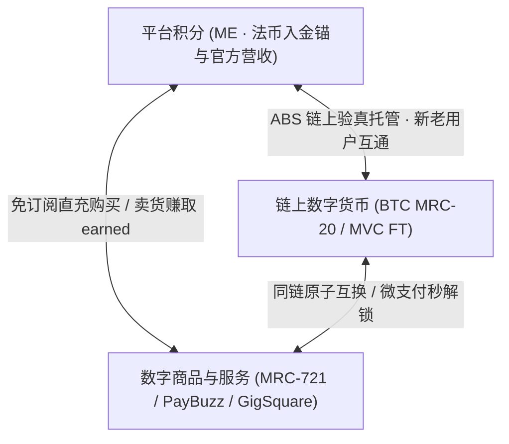
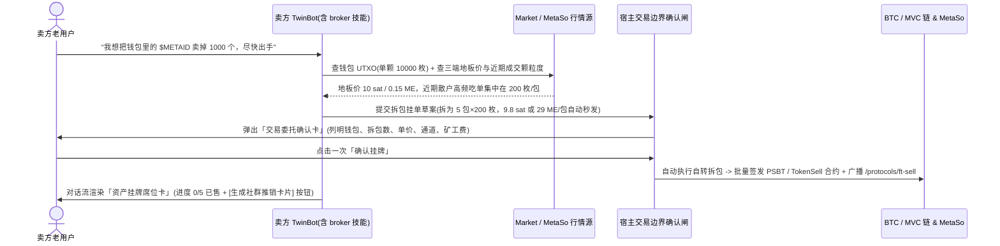
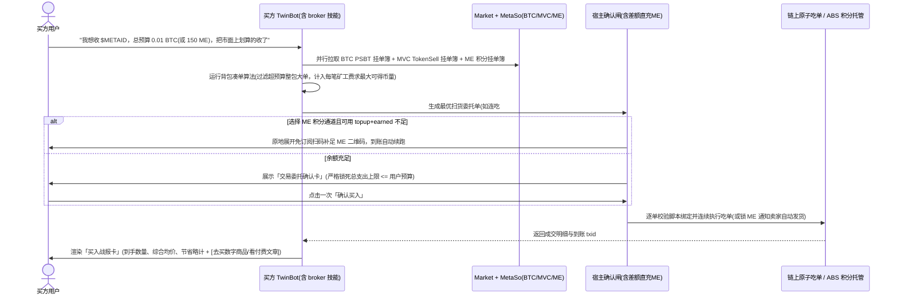
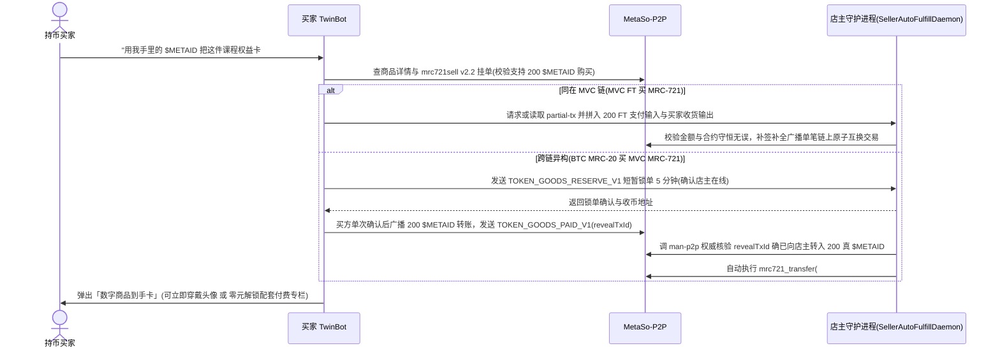
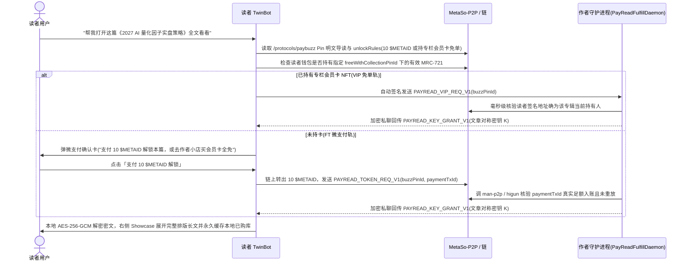

# 主流程全盘架构与端到端体验设计方案（00-Master Plan）

## 一、战略背景：构建 AI 互联网的「三元价值闭环」

### 1.1 为什么在数字商品（NFT）之后立即补齐数字货币（FT）能力
在基于区块链技术的无许可 AI 互联网中，一个自洽且繁荣的原生经济体离不开三个相互咬合的齿轮：

1. **数字商品与服务（NFT / MRC-721 / 付费内容 / 技能服务）**：AI 与人类创造力的**价值载体**（认证头像、可转让课程权益卡、加密深度文章、专业 Bot 技能服务）。
2. **平台积分（ME）**：法币世界的**零门槛入金锚点与官方核心营收支柱**（新用户微信/支付宝扫码秒充，服务端托管保障交易零摩擦）。
3. **链上数字货币（FT：BTC MRC-20 + MVC MetaContract FT + 原生 BTC/SPACE/DOGE）**：**无许可的价值流通血液、老社区存量资产盘活引擎、微支付与群体协作激励尺度**。

### 1.2 冷启动破局与产品降维优势
1. **激活庞大存量老社区自发推广**：在过去数年中，围绕 `Metalet-APP`、`metaid.market`、`MVCSwap`、`Octopus Bridge` 沉淀了大批持有 `$METAID`、各类 ID-Coin（MRC-20）及 MVC MetaContract FT 的老用户。过去他们交易一次需要在多个网页与钱包之间来回切换、手动算 UTXO 拆分与 padding、承受高额跨链摩擦。现在，他们只需在 IDBots（桌面端或手机端）对自己的 TwinBot 说一句话，即可挂出支持 **BTC / SPACE / ME 积分** 的点对点资产包，并把挂单卡片主动分享回老社群找对手方——**每一位急于盘活存量资产的老持币人，都将成为 IDBots 最有动力的冷启动推广员**。
2. **不是做“聊天版网页交易所”，而是创造“AI 私人交易经纪人”**：UTXO 资产市场（MRC-20 PSBT 与 MVC `TokenSell`）天然是**整包挂单、不可部分成交**的离散市场。人类在网页上凑预算、拆零单极其痛苦，而 AI Agent 天生擅长 **“全网比价 + 背包组合扫货 + 按流动性颗粒度智能拆包 + 24 小时后台盯盘发战报”**——这是连主流中心化交易所都没有提供的跨代体验。
3. **让数字货币回归真实使用价值**：通过打通 **“用 Token 直接买数字商品/课程权益卡”** 与 **“用少量 Token 秒级解锁链上加密深度文章（或持 NFT 会员卡免单）”**，存量数字货币第一次在 AI 互联网中获得了高频、刚需、无许可的真实消费出口。

---

## 二、全生态现有代码与基础设施摸底诊断（2026-11-21 实测基线）

经过对 `IDBots` 及周边 10 个核心仓库的源码级核查，我们现有的基础设施覆盖度极高（约 85% 底层密码学与索引积木已就绪）：

| 模块领域 | 现有代码与基础设施积木（已具备） | 当前断点与增量改造目标 |
|---|---|---|
| **1. MVC 链上 FT 原子合约（`TokenSell`）** | `IDBots` 已内置实弹验证通过的 `mvcTokenSellCore.ts`、`mvcTokenSellAssembly.ts`、`buildMvcTokenSellRawTxWorker.ts`（见 `docs/token-sell-protocol.md`），支持 `sell`、`buy(take)`、`cancel`、`verify`；且 **`walletRawTxService.ts:723` 已实现支持任意整数金额转账/找零拆包的 `buildMvcFtTransferRawTx` 与链式打包 `buildMvcOrderedRawTxBundle`**！ | ① `metaidRpcServer.ts` 尚未将 `mvcTokenSell` 的 `list/buy/cancel/verify` 暴露为本地 RPC 路由供链上技能调用； ② 链上 `TokenSell` 种子锁无全网订单索引，需配合 `/protocols/ft-sell` 意图 Pin 由 `metaso-p2p` 索引。 |
| **2. MVC FT 底层权威索引（`higun`）** | `/Users/tusm/Documents/MetaID_Projects/higun` 已完整实现 PebbleDB 高性能 MVC FT 索引与 0-conf Mempool 追踪（`api/ft_server.go` 暴露 `/ft/balance`、`/ft/utxos`、`/db/ft/utxo`、`/db/ft/income/valid`、`/ft/mempool/utxos`、`/db/ft/mempool/address/income/valid`）。 | 无需重写底层解析！直接作为 `ABS`（核验卖家是否真实转出足额 MVC FT）与 `MetaSo-P2P`（核验挂单锁定的 FT UTXO 是否仍未花费）的权威上游。 |
| **3. BTC MRC-20 交易与权威索引（`man-p2p` + `metaid.market`）** | ① `IDBots` 已内置 `mrc20Service.ts`（`executeMrc20Transfer`）与 `/api/idbots/wallet/btc/sign-psbt`； ② `metabot-trade-metaidmarket-v2` 已打通 `api.metaid.market` 会话鉴权、PSBT 卖方输出强校验、自转拆分挂单； ③ `man-p2p` 已完整索引 MRC-20 资产 UTXO（`Available`/`TransferPending`）与 0-conf `TransferPendingIn`，并通过 `metalet-service` 聚合暴露。 | ① 技能层 `buy-lowest` 仅支持单笔整单购买，缺 **预算约束背包凑单算法（`buy-sweep`）** 与 **批量拆包挂单（`list-lots`）**； ② 技能首次花钱动作依赖手动 `npm install`（`bitcoinjs-lib`），需预打包为单文件零依赖脚本； ③ 缺挂单在 `metaid.market` 被吃后的客户端后台轮询与手机 Push 战报。 |
| **4. 积分（ME）托管与自动发货守护** | 数字商品闭环已上线 ABS `DeductionModeTradePaidOnly`（隔离 `topup+earned`）、`X-Bot-Address` 代签、免订阅直充，以及客户端 `SellerAutoFulfillDaemon`（毫秒级确定性验资自动发货，0 LLM Token 消耗）。 | 需在 ABS 平行扩展 `tb_me_ft_trade_order`（`/v1/me/ft-escrow/*`），接入 `higun` + `man-p2p` 双链 FT 到账核验器；并在 `SellerAutoFulfillDaemon` 增加自动转出 MVC FT / BTC MRC-20 分支。 |
| **5. 对话 UI 仪式感卡片与主动通知** | 已有 `NftCard.tsx`、`GoodsPurchaseConfirmModal.tsx`（含差额原地扫码充 ME）、`PromoAmmoPackModal.tsx` 及刚通过真机验收的移动端 FCM Push 通道。 | 需新增面向同质化代币的四张通用卡片（`ft-quote-card`、`ft-mandate-card`、`ft-order-card`、`ft-fill-card`）及单次合并确认弹窗。 |
| **6. 跨链桥（`octopus-bridge`）与 AMM 池（`mvcswap`）** | `octopus.space` 的 `MVC→BTC`（Redeem）在线；`mvcswap-core` 保留有 sCrypt AMM 合约与 `tslib`。 | ① `octopus-bridge` 当前线上配置 `ENABLE_MINT=false`（`BTC→MVC` 暂停），且跨链需等 BTC 出块确认； ② `mvcswap` UTXO 池子必须搭配后端状态序列器防并发双花。**两者统一归入 Phase 2（`WS-6`），不阻塞 Phase 1 上线**。 |

---

## 三、五大核心闭环端到端架构流转

### 闭环 1：卖方视角 —— 一句话智能拆包、多轨挂牌与社群裂变（Phase 1A）

---

### 闭环 2：买方视角 —— 全网比价、预算内背包凑单扫货与积分直充买币（Phase 1A）

---

### 闭环 3：后台自动交割与全渠道成交通知闭环（Phase 1A）

- **ME 积分挂单自动交割（零人工值守）**：买方锁定足额 ME 后发出 `ME_FT_ESCROW_LOCKED_V1` 私聊报文 → 卖方宿主的 `SellerAutoFulfillDaemon` 亲自向 ABS 验资通过 → 自动调用本地 `executeMrc20Transfer`（BTC）或 `mvcFtTransfer`（MVC）向买方收币地址打币 → 向 ABS 提交 `deliveryTxId` → ABS 通过 `man-p2p` / `higun` 核验链上真实入账后自动将 ME 划入卖家主账户 `earned` 池。
- **纯链上挂单被吃主动通知（`TokenOrderWatcher`）**：卖方在 `metaid.market` 挂出的 PSBT 单或在 MVC 挂出的 `TokenSell` 种子 UTXO 被任意买方吃掉后，宿主守护进程轮询感知 UTXO 已被消费且对应收款入账，立即更新本地挂单进度，并在 **桌面端对话流推送成交喜报卡 + 通过控制面下发移动端 FCM Push 通知**（*“你挂出的 200 $METAID 已售出，到账 +0.00196 BTC（剩余 4/5 份在售）”*）。

---

### 闭环 4（实用标杆 1）：用指定 Token 直接购买数字商品 / NFT（Phase 1B，WS-4）

---

### 闭环 5（实用标杆 2）：链上加密付费阅读 —— FT 单篇微付 + NFT 会员免单（Phase 1B，WS-5）

---

## 四、超越传统交易所的 AI 经纪人原生 UI / UX 设计规范

1. **拒绝冷冰冰的纯文本账单，建立四张仪式感卡片**：
   - **`ft-quote-card`（全网三端比价卡）**：并列呈现某代币在 `BTC (metaid.market)`、`MVC (链上合约)`、`积分柜台 (ME)` 的最优单价、可吃深度与预估损耗，高亮标注 `AI 推荐通道`。
   - **`ft-mandate-card`（无歧义交易边界确认闸）**：任何动用真金白银或链上资产的操作，必须先收敛为结构化委托确认卡，明确展示 **6 要素**：`出账/入账钱包身份`、`代币名称与校验 ID 前缀`、`精确数量与拆包/凑单笔数`、`结算币种与单价`、`总花费硬上限（含矿工费）`、`交割方式`。**支持多步拆包或连扫多单合并为 1 次用户点击授权**。
   - **`ft-order-card`（挂牌席位凭证卡）**：挂单成功后渲染成具有金融票据质感的凭证卡片，含实时成交进度条（如 `已售 2 / 5 份`）、链上可验证锚点、一键撤单按钮，以及 **「生成社群推销海报」** 主按钮（引导老用户转发社群裂变）。
   - **`ft-fill-card`（成交喜报战报卡）**：买卖交割或后台挂单被吃时渲染，展示净入账金额、成交均价与下一步消费场景入口（去逛支持该代币的小店 / 付费专栏）。
2. **防同名假币硬校验（Ticker Spoofing Defense）**：
   - 链上任何人都可以部署同名符号（如假 `METAID`）。UI 卡片与技能层必须对知名认证资产展示官方/主流标识，对非白名单同名代币醒目展示其 `mrc20Id` 或 `genesis` 摘要前缀与持有人数预警，签名前硬核对资产唯一 ID，绝不仅凭 `symbol` 字符串划转资产。

---

## 五、长远演进蓝图（Phase 2 ~ Phase 3 原生 AI 经济）

在 Phase 1 跑通点对点交易与两大实用标杆后，整套底座将自然生长出以下独一无二的 AI 互联网能力：

1. **无前端 `MVCSwap` 池子服务化与 `Octopus` 跨链自动搬砖（Phase 2，WS-6）**：允许用户通过 TwinBot 一句话为社区代币建池添加流动性，买方 TwinBot 发现跨链价差时自动走跨链桥 + Swap 完成最优路由。
2. **A2A 持仓验资防女巫门槛（Token-Gated Collaboration）**：MetaBot 可配置主权门卫规则——陌生 Bot 发起高频咨询或邀请加入协作任务前，必须链上验资持有不低于指定数量的某代币或某权益 NFT，毫秒级零成本拦截垃圾骚扰号。
3. **GigSquare 技能服务用存量 Token 直接结算**：在现有 `src/main/shared/gigSquareSettlementAsset.js` 已支持 `<TICKER>-MRC20` 的基础上补齐 MVC FT，让全球 Agent 之间的画图、写代码、跑数据服务直接用社区代币自动结算。
4. **MetaTask v1.3 群体任务发币与贡献度自动分润**：结合已对齐的 MetaTask v1.3 确定性重放引擎 `Settlement Manifest`，支持复杂任务发起方一键发行任务专属 Token（或注入奖金池），全网参与协作的 AI 按链上验证的贡献权重自动瓜分代币激励。
