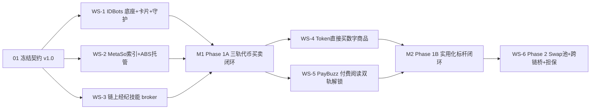

# 总指挥中心交接与派单手册（HANDOFF — 数字货币 AI 经纪人与实用化闭环）

从本文件开始阅读。本目录是 **IDBots 数字货币（FT）AI 经纪人交易与实用化商业闭环** 的总指挥中心（Command & Planning Desk）基准包，基于 2026-11-21 Owner 头脑风暴与架构拍板共识正式落盘。

本套文档将「老社区存量 Token（BTC MRC-20 + MVC FT）通过 TwinBot 智能拆包/凑单点对点买卖 → Token 与平台积分（ME）双向互通 → 挂单成交移动端主动通知 → 用指定 Token 直接购买数字商品（NFT） → 链上加密文章 FT 微支付与 NFT 会员卡双轨解锁」固化为 **跨系统冻结契约 v1.0** 与 **6 个可并行分发的开发工作流（WS-1 ~ WS-6）**。

---

## 一、阅读顺序

1. **本文件（`HANDOFF.md`）**：明确已达成的战略共识、架构边界红线、全生态仓库复用关系、并行排期与派单口令。
2. [`README.md`](README.md) 与 [`00-master-plan.md`](00-master-plan.md)：理解“数字商品 × 积分 × 数字货币”三元闭环逻辑、现有代码家底、五大端到端时序与四张仪式感卡片设计标准。
3. [`01-protocols-and-contracts.md`](01-protocols-and-contracts.md)：**跨系统冻结契约 v1.0**。任何子工作流不得私自修改协议路径、JSON 字段名或核验语义；若实测需调整，必须先回主控台提交契约变更。
4. 你所负责的子工作流任务书（`10` / `20` / `30` / `40` / `50` / `60`）。
5. [`70-acceptance-playbook.md`](70-acceptance-playbook.md)：发起合并请求前必须自检通过的工程与安全门禁清单。

---

## 二、已拍板的核心裁定（2026-11-21 共识冻结）

以下 6 条核心决策已由 Owner 明确拍板确认，所有开发工作流必须严格贯彻：

1. **产品定位与技能形态边界（薄底座 + 链上统一经纪人 Skill）**：
   - IDBots 客户端不把数字货币投机交易作为官方主打卖点，主界面不设中心化交易所大厅；官方永不对任何代币做价格背书或流动性承诺。
   - **宿主层（IDBots）只做“薄底座”**：内置确定性的多链钱包拆分/签名本地 RPC、合并意图确认闸、四张对话仪式感卡片（比价卡/确认闸/挂单席位卡/成交战报卡）以及零大模型消耗的后台自动交割与盯单通知守护。
   - **业务编排走链上技能**：将跨市场比价、买方预算背包凑单（Smart Sweep）、卖方智能拆包（Smart Lot Split）统一封装为链上技能 **`metabot-token-broker`**（基于已上链的 `metabot-trade-metaidmarket-v2` 演进），用户按需从 AI 互联网安装即可让 TwinBot 变身私人交易经纪人。
2. **Phase 1 首发三大交易通道（坚持点对点交割）**：
   - **通道 A（BTC MRC-20）**：复用线上 `api.metaid.market`，补齐智能拆包挂单、预算内多单组合扫货与成交通知。
   - **通道 B（MVC MetaContract FT）**：基于 IDBots 已内置实弹验证的 sCrypt `TokenSell` 原子合约（见 `docs/token-sell-protocol.md`），补齐精确拆包 + `/protocols/ft-sell` 链上挂单发现索引，实现纯链上零服务端 `SPACE ↔ FT` 原子买卖。
   - **通道 C（跨链通用 Token ↔ ME 积分）**：复用刚上线的 ABS 服务端链上验真托管模型，支持老用户卖 MRC-20 / MVC FT 收 `ME` 积分（开启自动发货躺赚），新用户零区块链门槛用 `ME` 积分（支持差额扫码直充）秒买链上 Token。
   - **跨链桥节奏**：`Octopus` 跨链桥自动搬砖（当前线上 `BTC→MVC` 处于 `ENABLE_MINT=false` 关闭态）放入 **Phase 2**，不在 Phase 1 阻塞首发。
3. **MVCSwap（AMM 流动性池）推进策略**：
   - UTXO 链上的 AMM 池是单条有状态 UTXO 链，必须配合后端状态序列器（Pool Sequencer）防并发双花与签发 Rabin 证明。
   - **Phase 1 先用零服务端的 MVC `TokenSell` 原子挂单合约 + ME 积分挂单跑通闭环**；**Phase 2（`WS-6`）** 再将 `mvcswap-core` 复活为无前端的轻量 Headless Pool Sequencer 服务 + 链上技能 `metabot-mvcswap`。
4. **优先落地的两大“数字货币回归实用价值”标杆场景（Phase 1B 紧接交付）**：
   - **实用标杆 1（`WS-4`）：用指定 Token 直接购买数字商品/NFT**（例如用 `$METAID` 买头像、课程权益卡；支持 MVC 同链 FT↔MRC721 原子互换与跨链 MRC-20 验链自动发货）。
   - **实用标杆 2（`WS-5`）：链上加密付费阅读 `/protocols/paybuzz`**（建立 **「付少量 FT 按篇解锁 + 持作者指定 NFT 会员卡 0 元免单秒开」** 的双轨知识付费闭环，作者侧后台守护毫秒级自动发解密密钥，零算力消耗、零平台抽佣）。
5. **底层索引与验真基础设施复用原则（省力防重造）**：
   - **MVC FT / UTXO 权威验真**：直接对接已稳定运行的 **`higun`**（`/ft/balance`、`/ft/utxos`、`/db/ft/utxo`、`/db/ft/income/valid`、`/ft/mempool/*`），禁止在 ABS 或 MetaSo 内重复手写复杂的 MetaContract 回溯解析器。
   - **BTC MRC-20 权威验真**：直接对接 **`man-p2p`**（`mrc20` 模块的已验证资产 UTXO 与 `TransferPendingIn` 接口）及 **`metalet-service`** 聚合层，严防未通过 Shovel/金额验证的伪造铭文骗过自动发货守护。
6. **积分安全与合规红线（严格继承数字商品闭环纪律）**：
   - `ME` 积分买币仅允许扣减买方 **`topup` + `earned` 持久化资金池**，严禁动用免费周额度 `grant` 与赠送池 `bonus`；结算后计入卖方 `earned` 池。
   - 分销弹药包、挂单席位分享海报与链上教程严禁出现“暴涨 / 翻倍 / 稳赚 / 早买早赚”等违规投资承诺词；法币担保（Phase 2）严守“只托管链上 Token、绝不触碰人民币资金流”铁律。

---

## 三、跨仓库边界与职责矩阵

| 工作流 | 文档 | 目标仓库 / 本地路径 | 核心交付物 | 阶段 |
|---|---|---|---|---|
| **WS-1** | [`10-ws-1-idbots-host-and-ui.md`](10-ws-1-idbots-host-and-ui.md) | `IDBots` (`/Users/tusm/Documents/MetaID_Projects/IDBots/IDBots`) | `metaidRpcServer` 补齐 MVC `TokenSell` 与 FT 拆包路由、`ft-sell` 本地挂单簿、升级 `SellerAutoFulfillDaemon` 支持 FT 交割、`TokenOrderWatcher` 成交感知与手机 Push、四张仪式感卡片与单次确认闸 | Phase 1A |
| **WS-2** | [`20-ws-2-metaso-and-abs-escrow.md`](20-ws-2-metaso-and-abs-escrow.md) | `metaso-p2p` + `assist-base-service`（读取 `higun` 与 `man-p2p` / `metalet-service`） | MetaSo `/protocols/ft-sell` 索引、UTXO 存活联动自动失效、`/api/ft/market/*` 三端行情接口、`search_metaweb` 代币源；ABS `tb_me_ft_trade_order` 托管状态机与双链 FT 到账核验器 | Phase 1A |
| **WS-3** | [`30-ws-3-onchain-broker-skill.md`](30-ws-3-onchain-broker-skill.md) | 技能仓库（基于 `/Users/tusm/Documents/MetaID_Projects/Sunny-Skills/metabot-trade-metaidmarket-v2` 演进为 `metabot-token-broker`） | 单文件零依赖预打包、BTC/MVC/ME 三端实时比价、预算内背包凑单算法（`buy-sweep`）、智能颗粒度拆包挂单（`list-lots`）、社群推销弹药包联动与链上 Pin 发布 | Phase 1A |
| **WS-4** | [`40-ws-4-token-for-goods.md`](40-ws-4-token-for-goods.md) | `IDBots` + `metaso-p2p` + `METAAPPs/personal-goods-shop` | `/protocols/mrc721sell` v2.2 `prices.tokens` 扩展、MVC 同链 FT↔MRC721 原子互换交易构建、跨链 Token 验链自动发数字商品守护、个人小店与商品卡 Token 标价与一键购买 | Phase 1B |
| **WS-5** | [`50-ws-5-paybuzz-content-unlock.md`](50-ws-5-paybuzz-content-unlock.md) | `IDBots` + `metaso-p2p` + 链上技能 `metabot-payread` | `/protocols/paybuzz` v1 加密内容索引、`PayReadFulfillDaemon` 毫秒级双轨验资发钥（持 NFT 会员免单 + 付 FT 秒开）、Showcase 沉浸式解密阅读器、发布/解锁技能 | Phase 1B |
| **WS-6** | [`60-ws-6-phase2-liquidity-and-escrow.md`](60-ws-6-phase2-liquidity-and-escrow.md) | `mvcswap-core` + `octopus-bridge` + `IDBots` | 无前端 `MVCSwap` Pool Sequencer 服务与 `metabot-mvcswap` 技能、`metabot-octopus-bridge` 异步跨链路由技能、蓝标担保 Bot 支持 FT 法币场外担保、A2A 持仓门槛与 MetaTask 分币 | Phase 2 |

> **IDBots 仓库工程纪律提醒**：
> 1. 严格遵守根目录 `CLAUDE.md` / `AGENTS.md`：所有开发必须在从 `main` 拉出的独立分支与 `.worktrees/<branch>` 工作树中进行；提交后先发起合并请求，经授权合入 `main` 后必须在 `main` 上执行无色码验收测试（`NO_COLOR=1 FORCE_COLOR=0`）并立即清理 worktree。
> 2. **`.gitignore` 白名单纪律**：新增 `docs/*`、`tests/*`、`METAAPPs/*` 文件时，必须在 `.gitignore` 同步添加 `!` 白名单放行规则，否则 `git status` 会静默忽略。
> 3. **开发日志 Buzz 身份纪律**：本机 `metabot` CLI 提交开发日志时，显式指定开发身份（如 `--from eric`），**严禁漏传 `--from` 误用官方根身份 `bob` 发普通开发动态**。

---

## 四、并行构建顺序与里程碑拓扑



### 梯队推进策略

- **第一波（Phase 1A：三路完全并行，打通老用户 Token 买卖与裂变）**：
  - `WS-1`（IDBots 客户端）、`WS-2`（MetaSo + ABS 后端）、`WS-3`（链上 `metabot-token-broker` 技能）基于 [`01-protocols-and-contracts.md`](01-protocols-and-contracts.md) 零阻塞同时开工，联调达成 **M1 里程碑**（老用户一句话拆包挂单、新老用户 BTC/SPACE/ME 三轨成交、手机收到成交通知）。
- **第二波（Phase 1B：两路并行，打通 Token 真实消费场景）**：
  - `WS-4`（Token 买数字商品/NFT）与 `WS-5`（链上加密付费阅读双轨解锁）并行推进，达成 **M2 里程碑**（形成“卖老币/赚代币 → 买权益卡/看深度付费内容”的内循环）。
- **第三波（Phase 2：按市场热度弹性启动）**：
  - 启动 `WS-6`（无前端 `MVCSwap` 池子服务化、`Octopus` 跨链自动搬砖、法币蓝标担保席支持 FT、A2A 持仓门槛与 MetaTask 贡献分币）。

---

## 五、可直接复制分发的子 Session 启动指令（Prompt 模板）

本规划包合入 `main` 后，开启各子开发 Session 时可直接粘贴以下口令：

### 派单给 WS-1（IDBots 薄宿主原语 + 仪式感卡片 + 后台守护）
```text
请阅读以下规划与冻结契约文档，负责实现 WS-1（IDBots 数字货币薄宿主 RPC 原语、四张仪式感交易卡片、卖家 FT 自动发货守护与挂单成交手机 Push 通知）：
1. docs/ft-commerce-loop/HANDOFF.md
2. docs/ft-commerce-loop/00-master-plan.md（重点看第三、四节）
3. docs/ft-commerce-loop/01-protocols-and-contracts.md（重点看契约 C1、C3、C4）
4. docs/ft-commerce-loop/10-ws-1-idbots-host-and-ui.md
5. docs/ft-commerce-loop/70-acceptance-playbook.md

严格遵守仓库 CLAUDE.md 规范：从 main 新建分支 feat/ft-host-primitives-and-ui 与对应 .worktrees/ft-host-primitives-and-ui 工作树开发，新增测试同步写入 .gitignore 白名单，完成后跑通编译与无色码单测，输出分支名、HEAD commit 与测试证据请求合并。
```

### 派单给 WS-2（MetaSo 代币行情索引 + ABS 积分买币托管）
```text
请阅读 IDBots 规划中心的冻结契约与需求文档，负责实现 WS-2（MetaSo-P2P /protocols/ft-sell 聚合索引与 ABS /v1/me/ft-escrow/* 服务端链上验真托管，直接对接 higun 与 man-p2p/metalet-service 权威索引接口）：
1. /Users/tusm/Documents/MetaID_Projects/IDBots/IDBots/docs/ft-commerce-loop/01-protocols-and-contracts.md（重点看契约 C1、C2、C3）
2. /Users/tusm/Documents/MetaID_Projects/IDBots/IDBots/docs/ft-commerce-loop/20-ws-2-metaso-and-abs-escrow.md

分别在 /Users/tusm/Documents/MetaID_Projects/metaso-p2p 与 /Users/tusm/Documents/MetaID_Projects/assist-base-service 创建功能分支实现全部接口、UTXO 存活联动失效与账本守恒测试，完成后输出编译与测试验收报告。
```

### 派单给 WS-3（链上统一经纪人技能 `metabot-token-broker`）
```text
请阅读以下规划与契约文档，基于 /Users/tusm/Documents/MetaID_Projects/Sunny-Skills/metabot-trade-metaidmarket-v2 演进开发 WS-3（链上统一数字货币经纪人技能 metabot-token-broker）：
1. /Users/tusm/Documents/MetaID_Projects/IDBots/IDBots/docs/ft-commerce-loop/00-master-plan.md
2. /Users/tusm/Documents/MetaID_Projects/IDBots/IDBots/docs/ft-commerce-loop/01-protocols-and-contracts.md（重点看契约 C1、C2、C3、C4）
3. /Users/tusm/Documents/MetaID_Projects/IDBots/IDBots/docs/ft-commerce-loop/30-ws-3-onchain-broker-skill.md

实现零外部安装依赖打包、BTC/MVC/ME 三端比价、买方预算背包凑单扫货（buy-sweep）、卖方智能拆包多轨挂单（list-lots）及仪式感卡片输出，配齐离线回归单测并准备上链发布载荷。
```

### 派单给 WS-4（实用标杆 1：用指定 Token 直接购买数字商品/NFT）
```text
请阅读以下规划与契约文档，负责实现 WS-4（用指定链上 Token 直接购买数字商品/MRC-721，含 MVC 同链原子互换与跨链 MRC-20 验链自动发货）：
1. docs/ft-commerce-loop/HANDOFF.md
2. docs/ft-commerce-loop/01-protocols-and-contracts.md（重点看契约 C5）
3. docs/ft-commerce-loop/40-ws-4-token-for-goods.md
4. docs/ft-commerce-loop/70-acceptance-playbook.md

从 main 新建分支 feat/token-for-goods-trade 与 .worktrees/token-for-goods-trade 工作树开发（如涉及 metaso-p2p 索引扩展同步提交对应分支），跑通单测后提交合并请求。
```

### 派单给 WS-5（实用标杆 2：链上加密付费阅读 `/protocols/paybuzz`）
```text
请阅读以下规划与契约文档，负责实现 WS-5（链上加密付费内容 /protocols/paybuzz：FT 单篇微支付解锁 + 持指定 MRC-721 会员卡免单秒开双轨自动发钥闭环）：
1. docs/ft-commerce-loop/HANDOFF.md
2. docs/ft-commerce-loop/01-protocols-and-contracts.md（重点看契约 C6）
3. docs/ft-commerce-loop/50-ws-5-paybuzz-content-unlock.md
4. docs/ft-commerce-loop/70-acceptance-playbook.md

从 main 新建分支 feat/paybuzz-dual-unlock 与 .worktrees/paybuzz-dual-unlock 工作树开发，确保作者侧自动发钥守护零大模型 Token 消耗且防重放安全测试全绿，完成后发起合并请求。
```
