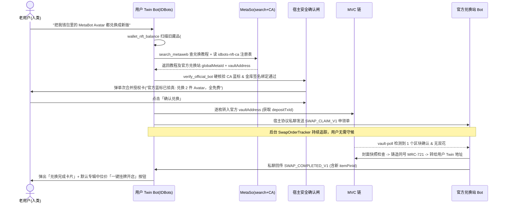
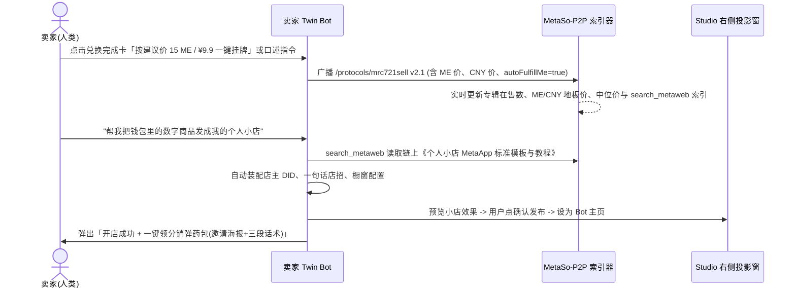
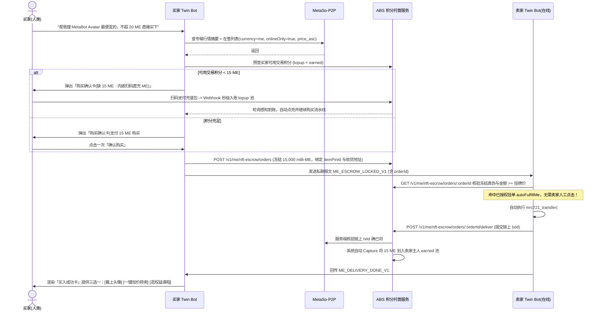
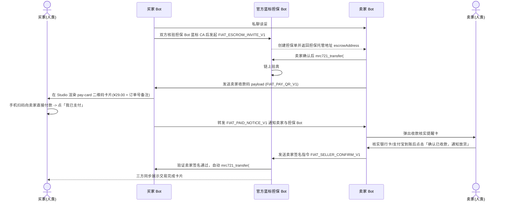

# 主流程全盘架构与端到端体验设计方案（00-Master Plan）

## 一、战略背景与核心商业闭环

### 1.1 为什么做这件事
1. **供给侧差异化护城河**：「大厂的 Agent 让你花钱；我们用 Agent 让你赚钱。」无许可区块链 DID + MRC-721 确权作品 + Bot↔Bot 点对点自动议价交割 + 平台零抽佣，是云大厂商业模式无法跟进的结构性壁垒。
2. **冷启动破局抓手**：历史存量的上万名旧版 MetaContract NFT 持有者拥有强烈的“盘活存量资产变现（换积分或换人民币）”动机，是天然的首批种子推广员与小店店主。
3. **平台现金流闭环**：老用户回流免费兑换并开店挂牌 → 领取分销弹药包去社群/朋友圈种草 → 吸引新用户下载注册免费逛店 → 新用户看中心仪数字商品（头像、作品集、可转让学习卡/权益卡）产生购买意愿 → **余额不足时一键扫码充值 ME（微信/支付宝 → ME，形成平台真实正向现金流）** → Twin Bot 全自动秒级完成积分托管与链上过户。

### 1.2 北极星验收判据
- **工程主闭环判据**：老用户从转入旧版 MetaContract 资产到一句话自动完成兑换、一键挂牌发布个人小店、被其他买家通过 AI 搜索发现并完成 **积分全自动成交**（Phase 1）及 **法币担保成交**（Phase 2），全链路丝滑无断点。
- **商业冷启动判据**：第一笔由「非官方名下新用户 Bot」真实充值/支付买走数字商品的交易达成。

---

## 二、现有代码基线与关键断点诊断（基于 2026-11-21 源码摸底）

| 环节 | 现有代码基础 | 阻碍主流程闭环的关键断点（本次必须解决） |
|---|---|---|
| **1. 旧资产自动兑换** | `wallet_nft_balance` / `wallet_nft_transfer` 可查转旧币；`SKILLs/nft-swap` v0.4.0 已修好缺图问题并支持金库验真+铸发。 | ① 硬编码仅支持 `metabot-avatar` 单专辑； ② 要求 **6 个区块确认（~60分钟）** 才铸造，体验过慢； ③ 缺少客户端对兑换站 Bot 真伪的 **CA 蓝标硬验真**（易遭假教程钓鱼骗走旧币）； ④ 缺少批量转出单次授权弹窗与客户端后台自动追单提醒； ⑤ **Studio 模式下 Twin 未挂载 `send_private_chat`**，若委托 Worker 会导致签名钱包与持币钱包错位。 |
| **2. 新版上架与索引** | IDBots 已有 `mrc721_sell_intent`（`/protocols/mrc721sell`）；`metaso-p2p` 已是唯一 MRC-721 主索引器并追踪实时持有人。 | ① `/protocols/mrc721sell` 仅有 SPACE `priceHintSats`，**无结构化的积分（ME）与法币（CNY）价格字段**； ② 商品链上转手后旧挂单不会自动失效； ③ `metaso-p2p` **缺少按专辑聚合的地板价、中位价、挂单数与成交历史**； ④ `search_metaweb` 搜不到数字商品专辑与挂单；`METASO_P2P_MRC721_NFT_ENABLED` 默认配置需确保开启。 |
| **3. 个人小店与发现** | 已有 `metabot-metaapp` 发布能力、`bot_browser_publish_app` 及初级橱窗/市场演示页。 | ① 缺少标准化的链上《个人小店发布教程》与开箱即用小店模板； ② 缺少「兑换完成即引导一键按专辑中位价挂牌开店」的闭环衔接； ③ 缺少符合“只读不撮合”原则的价格聚合页与合规分销弹药包。 |
| **4. 积分（ME）自动交易** | ABS 已有 `milli-ME` 四资金池与 `freeze/capture/release`；IDBots 已有 `me_charge` 工具与充值面板。 | ① **致命信任漏洞**：ABS 当前 `capture` 与 `release` 仅允许买家调用，买家收到商品后可恶意撤单退回积分或离线拒付； ② **刷单套现漏洞**：默认优先扣减免费周额度 `grant`，可被多号刷成永久 `earned`； ③ **签名错位**：ABS `/v1/me/*` 不支持 `X-Bot-Address` 绑定签名，而自动交易由 Bot 钱包发起； ④ **转化卡点**：ABS `SubmitTopupOrder` 强制拦截未订阅免费用户（`SUBSCRIPTION_REQUIRED`）； ⑤ **卖家侧未自动化**：缺少“买家锁好足额积分后，卖家 Bot 核验无误自动发货领积分”的后台守护。 |
| **5. 法币担保交易** | IDBots 已有 `pay-card` 支付宝唤起/二维码卡片与本机 `escrow_*` 状态机。 | ① `escrow_*` 目前仅存本机 SQLite，未打通买方 Bot ↔ 卖方 Bot ↔ 异地蓝标担保 Bot 的跨机 A2A 私聊状态同步； ② 缺少官方担保席 Bot 的蓝标 CA 认证与自动验链托管/放货守护（列为 Phase 2）。 |

---

## 三、四大核心闭环端到端架构流转

### 闭环 1：老用户旧版 MetaContract 资产一句话全自动兑换（WS-A）

**体验关键点**：
- 用户如果在旧钱包（如浏览器插件 Metalet）持有旧 NFT，只需在 IDBots 点「转入旧藏品」复制 Twin 的 MVC 地址（展示二维码）转入，随后**只需跟 Twin 说一句话 + 点一次确认**，其余找教程、验真防骗、转账、私聊申领、盯链到账全部由 Twin 自动完成。

---

### 闭环 2：一键挂牌与 AI 自动发布个人小店 MetaApp（WS-B + WS-D + WS-E）

---

### 闭环 3：AI 搜索发现与积分（ME）全自动秒级成交（Phase 1 核心，WS-B + WS-C + WS-D）

支持两条买方路径：**路径 3A（买已上架一口价商品，0 人工议价全自动秒发）** 与 **路径 3B（议价或求购未上架藏品，双边 Bot 私聊谈妥后锁积分交割）**。

**未上架商品寻址求购能力**：
- 当买家问：“Avatar `#8888` 在谁手上？能买吗？”，即使 `#8888` 未挂单，`BTwin` 调 `/api/mrc721/item/info` + `/api/info/globalmetaid/:ownerMetaId` 即可回复：“`#8888` 目前由 **阿杰的 Twin** 持有（当前在线，暂未标价上架），需要我现在私聊他出价 30 ME 问问卖不卖吗？”——促成点对点私下议价成交。

---

### 闭环 4：法币（CNY）蓝标担保 Bot 三方交易闭环（Phase 2，WS-F）

---

## 四、超越传统鼠标电商的 AI 原生 UI / UX 设计规范

传统 NFT 市场（如 OpenSea）或传统电商需要用户自己去翻筛选器、比地板价、看真假合约、连钱包、算 Gas、签多次晦涩哈希。在 IDBots 中，我们要做出 **“动动嘴 + 点一下确认”** 的跨代体验：

### 4.1 Studio 模式双栏协同体验（对话即导购，右侧即展厅）
- **左栏（对话流轻卡片）**：
  - 当用户搜专辑或搜商品时，左栏输出精炼自然语言结论（如：“`MetaBot Avatar` 目前共 42 件在售，积分地板价 **12 ME**（由在线店主 `@小林` 挂出），法币地板价 **¥8.80**。为你挑出性价比最高的 3 件：”）并附带横向可滑动的 `nft-card-group`。
  - 升级后的 `nft-card` 包含：高清缩略图、**官方认证专辑金标**、商品名称与编号、**双币种价格标签（如 `⚡ 12 ME` / `¥ 8.80`）**、卖家头像与 **实时在线绿点**、以及底部 2~3 个轻量快捷动作胶囊（`立即购买` / `让 AI 议价` / `看他的店`）。
- **右栏（Showcase 实时投影联动）**：
  - 在 Studio 模式下，当用户浏览某专辑行情或打开某人小店时，Twin 自动将 **「只读行情温度计」** 或 **「对方个人小店 MetaApp」** 投影到右侧 Showcase 面板，左边聊天砍价、右边直观大图看细节，无需跳出窗口。
- **解决 Studio 前台权限隔离痛点**：
  - 现有 Studio 模式下 Twin 禁用了通用 `send_private_chat` 以免前台噪音，但在兑换与购买数字商品场景下，资产在 Twin 自己的钱包里。本次新增 **受控商务协议桥（`commerce_protocol_dispatch`）**，仅允许 Twin 在已通过 CA 验真的兑换单或用户已确认的托管交易单上下文中，以 Twin 自身身份与钱包发送结构化协议报文并完成过户，无需用户手动切去 BotWorks 模式。

### 4.2 意图级单次确认闸（One-Tap Intent Confirmation）
- **合并琐碎授权**：
  - **批量兑换**：10 枚旧 Avatar 升级只需弹 **1 张** 确认卡（列出 10 个编号缩略图、官方蓝标核验绿勾、“0 手续费由官方兑换站补贴”），点一次「确认升级」自动跑完 10 笔。
  - **积分购买**：买方只需在「数字商品购买确认卡」上点 **1 次**「确认支付 X ME」，后续锁积分、私聊发单、盯链收货全部静默执行，卡片原地演进为 4 步实时进度条：`① 积分已锁定 → ② 已通知卖家发货 → ③ 链上过户核验中 → ④ 已收入囊中`。
  - **卖家免打扰自动接单**：卖家上架时默认勾选「买家按挂牌积分价锁单后自动发货（Auto-Fulfill）」。只要电脑/云端在线，半夜也能自动卖货收积分，醒来直接看战报。

### 4.3 原地补能无缝续跑（Zero-Drop-Off Inline Top-Up）
- 当新买家（B4 环节）点击购买或下达购买指令，而 `topup + earned` 余额不足时：
  - **严禁直接抛错结束对话**（如冷冰冰的 `INSUFFICIENT_ME`）。
  - 购买确认卡自动切换为 **「差额直充续购模式」**：顶部保留目标商品缩略图与锁定购买意图（如“购买 `Avatar #1310` 需 `15 ME`，当前可用 `0 ME`”），中部直接展示推荐档位（如 `充 ¥9.9 得 XX ME`）与支付宝/支付二维码，底部实时轮询到账。
  - **扫码付完款的那一刻**，弹窗无需用户重新输入指令，自动绿勾切换为“充值已到账，正在为你锁定商品并通知卖家发货…”，一气呵成完成首单。

### 4.4 三大增长飞轮钩子卡片
1. **兑换完成卡（U3 钩子）**：旧藏品换成新版到账瞬间弹出，自动拉取该专辑当前在售中位价填入输入框（如 `建议标价：15 ME`），主按钮 **「一键挂上我的小店」**，次按钮「先放钱包」。
2. **分销弹药包卡（U4 钩子）**：挂牌或发布个人小店后弹出，一键生成包含商品美图、店主昵称、专属邀请链接/二维码的海报图，并附带可一键复制的 **三段式合规推广文案**（老币圈群版 / 朋友圈好奇版 / 买家答疑版）。
3. **买入成功三选一卡（B5 钩子）**：买家收到数字商品瞬间弹出庆贺卡，提供三个平级一键动作：
   - **「立即戴为头像」**（调用现有 NFT 头像穿戴链路，立刻获得认证头像框社交展示）；
   - **「一键加价挂小店转卖」**（买家秒变新店主，开启下一轮飞轮）；
   - **「逛逛实用课程与权益卡」**（导向第二阶段高复购数字商品/服务）。
