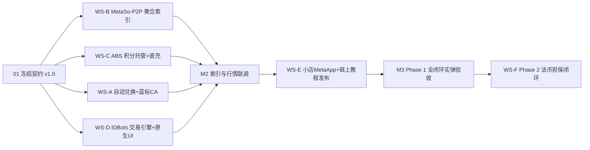

# 总指挥中心交接与派单手册（HANDOFF — 数字商品商业闭环与冷启动）

从本文件开始阅读。本目录是 **IDBots 数字商品（Agent Goods）主流程闭环** 的总指挥中心（Command & Planning Desk）基准包，产出于 2026-11-21。

本套文档将「老用户旧版 MetaContract NFT 自动兑换 → 一键开店上架 → AI 全网检索与专辑行情聚合 → 积分（ME）Bot↔Bot 全自动交易 → 法币（CNY）担保 Bot 交易 → 留存与分销裂变」拆解为 **跨系统冻结契约** 与 **6 个独立可分发的开发工作流（WS-A ~ WS-F）**。其他开发 Session 按各自领受的工作流文档独立开发，完成后回到主控 Session 按 [`70-acceptance-playbook.md`](70-acceptance-playbook.md) 统一验收。

---

## 一、阅读顺序

1. **本文件（`HANDOFF.md`）**：明确已拍板裁定、红线、仓库边界、并行开发顺序与派单口令。
2. [`README.md`](README.md) 与 [`00-master-plan.md`](00-master-plan.md)：理解商业闭环全局架构、端到端时序与 AI 原生 UI/UX 设计标准。
3. [`01-protocols-and-contracts.md`](01-protocols-and-contracts.md)：**跨系统冻结契约**（链上协议扩展、MetaSo-P2P 接口、ABS 积分托管接口、Bot 私聊报文）。任何子 Session 不得单方面篡改契约字段；确需变更须先回主控台提变更单。
4. 你所负责的子工作流需求书（`10` / `20` / `30` / `40` / `50` / `60`）。
5. [`70-acceptance-playbook.md`](70-acceptance-playbook.md)：提交合并请求前必须自检通过的门禁清单。

---

## 二、已拍板的核心裁定（全员硬约束）

以下决策已由 Owner 与主控台于 2026-11-20 ~ 2026-11-21 拍板，所有子工作流必须严格执行：

1. **对外命名与心智红线**：
   - 所有面向普通用户的 UI、卡片、小店、行情页、推广文案统一称为 **「数字商品」（Agent Goods）** 或 **「藏品 / 作品」**，**严禁在主界面对外暴露生涩的“NFT”字样**（仅在“旧版 MetaContract 资产导入/兑换”专项说明与底层协议字段中保留技术术语）。
   - **官方身份三处红线**：官方身份（及官方蓝标）仅出现在 **① 兑换公告、② 官方兑换/担保工具验真、③ 只读行情读数** 三处。官方永不承诺升值、官方 Bot 永不下场拉盘刷量、正式话术严禁出现“会涨 / 早买早赚”。
   - **去中心化成交场域**：不做 OpenSea 式的中心化撮合交易大厅；价格聚合页（行情温度计）**只读不撮合**；一切成交发生在用户的 **个人小店（Bot 主页换壳）** 与 **Bot↔Bot 私聊** 中。
2. **积分（ME）交易资金池与直充规则（拍板项 #1）**：
   - 数字商品交易扣款 **仅允许动用持久化付费/经营池（`topup` 充值池 + `earned` 收入池）**，**严禁动用每周免费额度（`grant`）与活动赠送池（`bonus`）**，从根源上阻断多账号刷单套取永久积分。
   - **开放免订阅直充 ME**：解除 ABS `SubmitTopupOrder` 对“必须先持有付费订阅（`SUBSCRIPTION_REQUIRED`）”的前置拦截，允许免费注册的新买家在下单余额不足时直接扫码购买 ME 充值包并无缝续接交易。
   - **ABS 服务端链上验真托管**：禁止沿用旧版“仅买方有权调 `capture/release`”的客户端自律模式；数字商品积分交易必须走 ABS 新增的服务端托管订单状态机（买方锁积分 → 卖方链上发 MRC-721 → ABS 核验链上过户成功后自动划转至卖方 `earned` 池）。
3. **旧版 MetaContract 兑换扩展性与确认速度（拍板项 #2）**：
   - 兑换引擎（`nft-swap` 与客户端验真）重构为 **多专辑配置表驱动**（以 `(collectionSlug, tokenIndex)` 为复合主键，首批发 `metabot-avatar`，后续新增老专辑仅需追加配置与 CA 条目，无需改代码）。
   - 金库入账确认门槛从 6 确认（约 60 分钟）降至 **1 确认**（配合 mempool 双花检查与 UTXO 在库复核），并在 IDBots 客户端内置 **后台自动追单守护（`SwapOrderTracker`）**，到账自动弹出「兑换完成 → 一键挂牌开店」引导卡片。
   - 防钓鱼硬门禁：通过扩展 `/protocols/idbots-nft-ca` 下发官方服务 Bot 蓝标清单，IDBots 宿主层强制校验兑换站 `globalMetaId` 与金库地址匹配官方 CA 签名，未通过验真严禁转出旧资产。
4. **排期切分（拍板项 #3）**：
   - **Phase 1（主闭环冲刺，当前立即分发执行）**：交付 `WS-A`（自动兑换+蓝标 CA）+ `WS-B`（MetaSo-P2P 上架聚合索引与检索）+ `WS-C`（ABS 积分托管与免订阅直充）+ `WS-D`（IDBots 积分自动交易与 Studio/BotWorks AI 原生 UI）+ `WS-E`（个人小店 MetaApp、只读行情页、弹药包与链上教程）。
   - **Phase 2（紧接 Phase 1 跑通后启动）**：交付 `WS-F`（法币人民币蓝标担保 Bot 三方托管、收款码转发与确认放货闭环）。协议与 UI 扩展点在 Phase 1 一次预留到位。
5. **定价币种范围**：
   - 现阶段上架与交易仅向用户开放 **积分（ME）** 与 **法币（CNY 人民币）** 两种定价，UI 层暂不引导数字货币（SPACE/BTC）挂牌。

---

## 三、跨仓库边界与职责矩阵

| 工作流 | 文档 | 目标仓库 / 路径 | 核心交付物 | 阶段 |
|---|---|---|---|---|
| **WS-A** | [`10-ws-a-swap-and-ca.md`](10-ws-a-swap-and-ca.md) | `IDBots` (`/Users/tusm/Documents/MetaID_Projects/IDBots/IDBots`) + `SKILLs/nft-swap` | `/protocols/idbots-nft-ca` 蓝标 Bot 验真、单次批量兑换授权卡、`nft-swap` v0.5 多专辑+1确认、后台追单守护、Studio Twin 兑换通道 | Phase 1 |
| **WS-B** | [`20-ws-b-metaso-indexer.md`](20-ws-b-metaso-indexer.md) | `metaso-p2p` (`/Users/tusm/Documents/MetaID_Projects/metaso-p2p`) | `/protocols/mrc721sell` v2.1 索引（ME/CNY 定价）、UTXO 转手自动失效、专辑地板价/中位价/在售数聚合、未上架持有人寻址、`search_metaweb` 商品源、CA 蓝标全量投影 | Phase 1 |
| **WS-C** | [`30-ws-c-abs-points-escrow.md`](30-ws-c-abs-points-escrow.md) | `assist-base-service` (`/Users/tusm/Documents/MetaID_Projects/assist-base-service`) | `tb_me_nft_trade_order` 服务端链上验真托管 API、`topup+earned` 专用扣款池、`X-Bot-Address` 绑定鉴权、免订阅直充 ME 开关与小额包 | Phase 1 |
| **WS-D** | [`40-ws-d-idbots-trade-and-ui.md`](40-ws-d-idbots-trade-and-ui.md) | `IDBots` (`/Users/tusm/Documents/MetaID_Projects/IDBots/IDBots`) | 上架工具 v2.1、买家积分托管下单工具、卖家挂单价后台自动发货守护、Studio Twin 协议直通、交互式商品卡/兑换即开店卡/原地充 ME 续单弹窗/买入三选一卡 | Phase 1 |
| **WS-E** | [`50-ws-e-metaapps-and-onchain-docs.md`](50-ws-e-metaapps-and-onchain-docs.md) | `IDBots/METAAPPs` + `botBrowserBridgeService` + 链上发布脚本 | 个人小店 MetaApp（Bot 主页换壳）模板、只读价格聚合页 MetaApp、分销弹药包生成器、3 篇链上标准教程/技能 Pin | Phase 1 |
| **WS-F** | [`60-ws-f-fiat-escrow-phase2.md`](60-ws-f-fiat-escrow-phase2.md) | `IDBots` + 官方担保 Bot 实例 | 跨机 A2A 法币担保协同协议、蓝标担保 Bot 自动验货/放货守护、买方 Studio `pay-card` 扫码与卖方收款确认流 | Phase 2 |

> **工程纪律提醒（IDBots 仓库）**：
> 1. 所有对 `IDBots` 的代码修改必须遵守根目录 `CLAUDE.md` / `AGENTS.md`——从 `main` 创建独立分支与 `.worktrees/<branch>` 工作树，严禁直接在 `main` 工作区改代码；完成后提交分支并向主控台请求合并，合入 `main` 后在 `main` 跑全量编译与测试（`NO_COLOR=1 FORCE_COLOR=0`）并清理 worktree。
> 2. **`.gitignore` 白名单纪律**：本仓库 `.gitignore` 默认忽略 `docs/*`、`tests/*`、`METAAPPs/*` 并采用显式 `!` 白名单放行。子工作流凡新增测试文件（`tests/*.test.*`）或内置模板应用（`METAAPPs/<name>/**`），必须在 `.gitignore` 同步追加对应的 `!tests/...` 或 `!METAAPPs/...` 白名单条目，确保 `git status` 可见且被纳入提交。
> 3. 注意当前主机磁盘剩余空间较紧（约 29 GB），任务结束后务必清理临时产物与已合并的 worktree。

---

## 四、并行构建顺序与里程碑拓扑



### 并行启动策略（Day 1 可四路齐发）

- **第 1 梯队（零外部阻塞，可立即并行开启 4 个开发 Session）**：
  1. **Session 1（后端索引）→ `WS-B`**：在 `metaso-p2p` 按契约 C1/C2/C3 开发，自带单元测试与本地回放验证。
  2. **Session 2（积分后端）→ `WS-C`**：在 `assist-base-service` 按契约 C4 开发，自带 GORM 迁移与 Go 单测。
  3. **Session 3（兑换与 CA）→ `WS-A`**：在 `IDBots` 新建 worktree `feat/nft-swap-auto-ca` 开发蓝标 CA 扩展、自动兑换闭环与 `nft-swap` v0.5。
  4. **Session 4（交易与 UI）→ `WS-D`**：在 `IDBots` 新建 worktree `feat/agent-goods-trade-ui` 基于契约 C2/C3/C4 的 Mock Client 先行开发全部工具、卖家自动发货守护与 Studio/BotWorks 四大交互卡片（注意与 `WS-A` 避开同一文件冲突，文件归属切分已写在 `10` 与 `40` 中）。
- **第 2 梯队（契约落定或与第 1 梯队后半程重叠）**：
  5. **Session 5（小店与教程）→ `WS-E`**：开发个人小店 MetaApp 模板、只读价格聚合页 MetaApp、分销弹药包，并在测试/主网发布链上兑换教程与开店教程。
- **第 3 梯队（M3 积分主闭环跑通后启动）**：
  6. **Session 6（法币担保）→ `WS-F`**：打通跨机 A2A 法币担保 Bot 闭环。

---

## 五、可直接复制分发的子 Session 启动指令（Prompt 模板）

将本规划分支合并入 `main`（或直接指向本目录绝对路径）后，新建开发 Session 时可直接粘贴对应指令：

### 派单给 WS-A（自动兑换 + 官方蓝标 CA）
```text
请阅读以下规划与契约文档并负责实现 WS-A（旧版 MetaContract 自动兑换闭环 + 官方身份蓝标 CA 验真）：
1. docs/nft-commerce-loop/HANDOFF.md
2. docs/nft-commerce-loop/01-protocols-and-contracts.md（重点看契约 C1、C5.1）
3. docs/nft-commerce-loop/10-ws-a-swap-and-ca.md
4. docs/nft-commerce-loop/70-acceptance-playbook.md

严格遵守仓库 CLAUDE.md 规范：从 main 新建分支 feat/nft-swap-auto-ca 与对应 .worktrees/nft-swap-auto-ca 工作树进行开发，严格留在文件边界内，完成后跑通相关测试并输出分支名、HEAD commit、变更清单与测试证据供主控台验收合并。
```

### 派单给 WS-B（MetaSo-P2P 聚合索引与检索）
```text
工作目录切换到 /Users/tusm/Documents/MetaID_Projects/metaso-p2p。
请阅读 IDBots 规划中心的契约与需求文档并负责实现 WS-B（数字商品上架聚合索引、专辑地板价/中位价、未上架持有人寻址、CA 蓝标投影与 search_metaweb 商品检索）：
1. /Users/tusm/Documents/MetaID_Projects/IDBots/IDBots/docs/nft-commerce-loop/01-protocols-and-contracts.md（重点看契约 C1、C2、C3）
2. /Users/tusm/Documents/MetaID_Projects/IDBots/IDBots/docs/nft-commerce-loop/20-ws-b-metaso-indexer.md

请按 metaso-p2p 规范创建功能分支实现全部接口与自动失效逻辑，补齐 Go 单元测试并输出完整的编译、单测与接口示例响应报告供主控台验收。
```

### 派单给 WS-C（ABS 积分服务端托管与免订阅直充）
```text
工作目录切换到 /Users/tusm/Documents/MetaID_Projects/assist-base-service。
请阅读 IDBots 规划中心的契约与需求文档并负责实现 WS-C（积分服务端链上验真托管订单、topup+earned 专用交易扣款池、X-Bot-Address 绑定签名与免订阅直充 ME）：
1. /Users/tusm/Documents/MetaID_Projects/IDBots/IDBots/docs/nft-commerce-loop/01-protocols-and-contracts.md（重点看契约 C4）
2. /Users/tusm/Documents/MetaID_Projects/IDBots/IDBots/docs/nft-commerce-loop/30-ws-c-abs-points-escrow.md

请创建功能分支完成数据表幂等迁移、服务端托管状态机、链上 MRC-721 转移核验与直充改造，确保账本守恒检查（ComputeConservation）与并发竞态测试全部通过，完成后输出验收报告。
```

### 派单给 WS-D（IDBots 积分自动交易与 AI 原生 UI）
```text
请阅读以下规划与契约文档并负责实现 WS-D（IDBots 积分自动交易引擎、卖家自动发货守护与 Studio/BotWorks AI 原生数字商品交互 UI）：
1. docs/nft-commerce-loop/HANDOFF.md
2. docs/nft-commerce-loop/00-master-plan.md（重点看第四节 UI/UX 设计标准）
3. docs/nft-commerce-loop/01-protocols-and-contracts.md（重点看契约 C2、C3、C4、C5.2）
4. docs/nft-commerce-loop/40-ws-d-idbots-trade-and-ui.md
5. docs/nft-commerce-loop/70-acceptance-playbook.md

严格遵守仓库 CLAUDE.md 规范：从 main 新建分支 feat/agent-goods-trade-ui 与对应 .worktrees/agent-goods-trade-ui 工作树进行开发，完成后跑通编译与单测并输出合并请求报告供主控台验收。
```

### 派单给 WS-E（个人小店 MetaApp + 只读行情页 + 链上教程与弹药包）
```text
请阅读以下规划与契约文档并负责实现 WS-E（个人小店 MetaApp 模板、只读价格聚合页 MetaApp、Bot Browser 交易唤起桥、分销弹药包与链上兑换/开店/交易标准教程）：
1. docs/nft-commerce-loop/HANDOFF.md
2. docs/nft-commerce-loop/01-protocols-and-contracts.md
3. docs/nft-commerce-loop/50-ws-e-metaapps-and-onchain-docs.md
4. docs/nft-commerce-loop/70-acceptance-playbook.md

严格遵守仓库 CLAUDE.md 规范：从 main 新建分支 feat/agent-goods-shop-metaapps 与对应 .worktrees/agent-goods-shop-metaapps 工作树进行开发，完成后输出合并请求报告供主控台验收。
```

---

## 六、回交主控台的验收交付格式

每个子 Session 完成开发后，必须向用户/主控台提交包含以下 5 要素的交接单：

1. **仓库与分支信息**：仓库路径、分支名、`HEAD` commit hash。
2. **需求条目对照表**：逐条列出对应 `WS-*` 文档中的 `REQ-*` 编号、完成状态与关键代码路径（`file:line`）。
3. **契约一致性声明**：确认所有 HTTP 路由、JSON 字段名、Pin 路径与私聊报文头与 `01-protocols-and-contracts.md` 100% 字节级对齐（若有偏差，明确列出）。
4. **本地编译与测试证据**：附上真实执行的编译命令退出码、`NO_COLOR=1 FORCE_COLOR=0` 下的测试总数 / 通过数 / 失败数。
5. **待主控台合流动作**：如需要上链发布 CA 更新 Pin、配置环境变量或执行数据库迁移，清晰列出操作命令。
